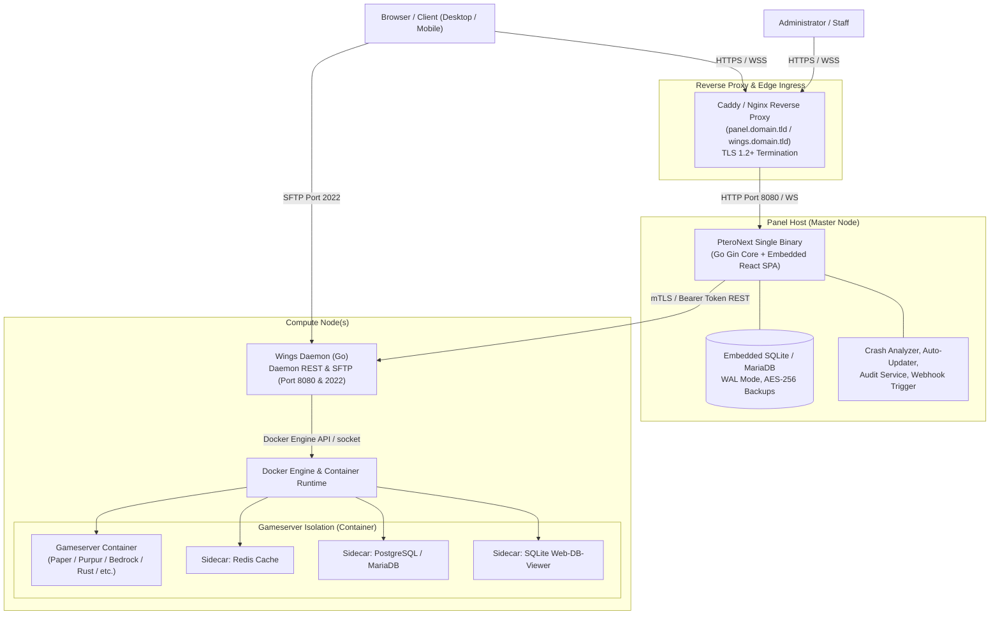

# 🦅 PteroNext & Wings — Vollständige Systemdokumentation

<p align="center">
  
  
  
  
</p>

---

## 📑 Inhaltsverzeichnis

1. [Projekt-Überblick & Architektur](#1-projekt-überblick--architektur)
   - [Architektur-Übersicht & Komponenten](#architektur-übersicht--komponenten)
   - [Architekturdiagramm](#architekturdiagramm)
   - [Technologie-Stack & Performance-Vorteile](#technologie-stack--performance-vorteile)
2. [Features & Technische Highlights](#2-features--technische-highlights)
   - [Live Player Tracker & Chunk-Rendering](#live-player-tracker--chunk-rendering)
   - [Live Console, ANSI-Farbunterstützung & DOMPurify Sanitization](#live-console-ansi-farbunterstützung--dompurify-sanitization)
   - [Intelligent Crash Analyzer & 1-Klick-Reparatur](#intelligent-crash-analyzer--1-klick-reparatur)
   - [Sicherheits-Architektur & Kryptographie](#sicherheits-architektur--kryptographie)
   - [Subuser-Management & Granulare Zero-Trust Berechtigungen](#subuser-management--granulare-zero-trust-berechtigungen)
   - [Sidecar-Container & Web-DB-Viewer](#sidecar-container--web-db-viewer)
   - [Automatisierungen & Webhook-Trigger](#automatisierungen--webhook-trigger)
   - [SFTP-Server & Multi-Node Cluster](#sftp-server--multi-node-cluster)
3. [Installation & Quickstart](#3-installation--quickstart)
   - [Systemvoraussetzungen](#systemvoraussetzungen)
   - [Panel Quickstart & Automatisierte Deployment-Skripte](#panel-quickstart--automatisierte-deployment-skripte)
   - [Systemd Service Konfiguration](#systemd-service-konfiguration)
   - [Reverse Proxy Setup (Caddy & Nginx mit TLS)](#reverse-proxy-setup-caddy--nginx-mit-tls)
   - [Wings Daemon Installation, Enrollment & Systemd](#wings-daemon-installation-enrollment--systemd)
4. [API & CLI Referenz](#4-api--cli-referenz)
   - [Panel REST API Endpunkte](#panel-rest-api-endpunkte)
   - [WebSocket Echtzeit-Schnittstellen](#websocket-echtzeit-schnittstellen)
   - [Wings CLI Flags & Kommandos](#wings-cli-flags--kommandos)
   - [Panel Core CLI Flags](#panel-core-cli-flags)
5. [Sicherheitsrichtlinien & Best Practices](#5-sicherheitsrichtlinien--best-practices)
   - [TLS 1.2+ & Zertifikats-Lifecycle](#tls-12--zertifikats-lifecycle)
   - [Firewall-Konfiguration & Port-Matrix](#firewall-konfiguration--port-matrix)
   - [Point-in-Time Backups & Disaster Recovery](#point-in-time-backups--disaster-recovery)
6. [Entwicklung, Build & Deployment](#6-entwicklung-build--deployment)
   - [Entwicklungsumgebung einrichten](#entwicklungsumgebung-einrichten)
   - [Frontend Build (Vite & TypeScript)](#frontend-build-vite--typescript)
   - [Backend Single-Binary Compilation (Go `embed`)](#backend-single-binary-compilation-go-embed)
   - [Docker Build](#docker-build)
   - [Remote-Deployment & Delta-Updates auf Live-Server](#remote-deployment--delta-updates-auf-live-server)

---

## 1. Projekt-Überblick & Architektur

**PteroNext** ist eine moderne, cloud-native Game-Server-Management-Plattform entwickelt von **Springi-SFM**. Sie wurde als vollständige Weiterentwicklung und Ersatz für klassische, mehrschichtige Legacy-Panel-Architekturen geschaffen.

Klassische Lösungen basieren auf komplexen PHP-Stacks (Laravel, Composer, PHP-FPM, Nginx, Redis-Queue-Worker, MySQL). PteroNext bündelt hingegen das gesamte Backend inklusive Datenbanktreibern und das kompilierte **React 18 / Vite / TypeScript Frontend** in einer **einzigen, hochperformanten, statischen Go-Binary** (`pteronext-core`).

### Architektur-Übersicht & Komponenten

| Komponente | Technologie | Aufgabe & Funktionsweise |
|---|---|---|
| **PteroNext Panel Core** | Go 1.22+, Gin, GORM, SQLite (WAL) | REST API, WebSocket Server, Auth-Engine, Backup-Engine, Sidecar-Manager und statischer HTTP-Server für das SPA Frontend. |
| **PteroNext Frontend** | React 18, Vite, TypeScript, TailwindCSS | Moderne Benutzeroberfläche mit Live-Telemetrie, interaktivem Terminal, Welt-Viewer, Sidecar-Viewer und Dark/High-Contrast Themes. |
| **Wings Daemon** | Go, Docker API, libcontainer/gVisor | Node-Agent auf Compute-Servern. Steuert Docker-Container, SFTP-Subsystem, I/O-Streams und Ressourcenbegrenzung (cgroups). |
| **Reverse Proxy** | Caddy v2 oder Nginx | Terminiert TLS-Zertifikate (Let's Encrypt / ZeroSSL), leitet Traffic an Panel (HTTP/WS) und Wings weiter. |
| **Container Sidecars** | Docker Engine | Zusatzdienste pro Gameserver: Redis Caches, PostgreSQL, MariaDB oder SQLite Web-DB-Viewer im isolierten Docker-Netzwerk. |

### Architekturdiagramm



### Technologie-Stack & Performance-Vorteile

1. **Kein PHP-FPM, kein Apache, keine Abhängigkeiten**: Die Standalone-Binary läuft out-of-the-box ohne externe Runtimes.
2. **Minimaler Speicherverbrauch**: Das Panel benötigt im Leerlauf weniger als **35 MB RAM** (im Vergleich zu 400+ MB bei klassischen Laravel/PHP-FPM Stacks).
3. **Sub-Millisekunden Latenz**: Go Goroutinen bedienen WebSockets und REST-Anfragen parallel mit minimalem CPU-Overhead.
4. **Zero-Locking SQLite mit WAL (Write-Ahead Logging)**: Extrem hohe Lese- und Schreibdurchsätze ohne externe Datenbank-Wartung.
5. **Single-Binary Delivery via `go:embed`**: Frontend und Backend werden in eine einzige Datei kompiliert. Deployments sind einfache Binary-Ersetzungen in unter 3 Sekunden.

---

## 2. Features & Technische Highlights

### Live Player Tracker & Chunk-Rendering
- **NBT-Parsing & Live-Koordinaten**: Liest Spielerdaten (`Pos`, `Rotation`, `Health`, `Dimension`, `Gamemode`) direkt aus `playerdata/<UUID>.dat` NBT-Dateien im Serververzeichnis.
- **Automatische Synchronisation via `save-all` Flush**:
  - Da Paper/Purpur-Server Spielerkoordinaten primär im Arbeitsspeicher puffern und nur periodisch oder beim Disconnect schreiben, triggert PteroNext bei Tracker-Abfragen im Panel einen gedrosselten `save-all` Konsolenbefehl (maximal alle 5 Sekunden).
  - Dadurch spiegeln die Koordinaten stets den aktuellen Live-Stand wider, ohne Server-Lags zu erzeugen.
- **Interaktiver World-Viewer**: Visualisiert Minecraft `.mca` Anvil Chunks und Regionen im Browser per HTML5 Canvas mit Live-Spielermarkern, TP-Shortcut und Spielerinventar-Inspektion.

### Minecraft World Manager & Multi-Dimension Controls
- **Multi-World Verwaltung**: Vollautomatische Erkennung aller auf dem Server befindlichen Weltenordner (z.B. `world`, `lobby`, `survival`).
- **Aktiver Weltenwechsel**: Synchronisiert die aktive Hauptwelt direkt mit `server.properties` (`level-name`) ohne manuelle Konfigurationsdatei-Bearbeitung.
- **1-Klick-Dimension-Resets**:
  - **Nether Reset (`DIM-1` / `world_nether`)**: Bereinigt korrumpierte oder ausgebeutete Nether-Chunks, regeneriert Festungen, Bastionen und Antiken Schrott frisch beim nächsten Portal-Betreten.
  - **End Reset (`DIM1` / `world_the_end`)**: Setzt das Ende zurück, regeneriert die Hauptinsel für neue Enderdrachen-Kämpfe und frische End-Städte mit Elytren.
  - **Sicherheits-Garantie**: Die Overworld (`region/`), Spielerinventare und Fortschritte bleiben zu 100% geschützt und unberührt.
- **Live Gamerule Steuerung**: Direkte Konsolen-Toggles für `keepInventory`, `mobGriefing`, `doDaylightCycle`, `doWeatherCycle` und `doFireTick`.
- **1-Klick ZIP-Sicherung**: Erzeugt sofortige `.zip` Backups einzelner Welten direkt im Hauptverzeichnis.
- **Vollständige Mehrsprachigkeit**: Alle Dialoge, Warnhinweise und Erfolgsmeldungen sind nativ in Deutsch und Englisch implementiert.

### Gehostete Uptime- & Statusseiten (`pteronext.com/status/{project}`)
- **Öffentliche Verfügbarkeitsseiten**: Ermöglicht Administratoren das Erstellen mandantenfähiger, öffentlicher Status-Seiten unter `pteronext.com/status/{project}`.
- **Echte Telemetrie ohne Mock-Daten**: Kontinuierliche Verfügbarkeits- und Latenzprüfung von Daemons, Webdiensten und Game-Servern.
- **Discord Webhook Alerting**: Automatisches Senden strukturierter Embeds an Discord-Kanäle bei Vorfällen oder Wartungen.
- **Ressourcenschonendes Quota**: Striktes Kontingent von 1 Statusseite pro Panel-Instanz zur Vermeidung von Infrastruktur-Missbrauch.
- **Rechtlicher Compliance-Footer**: Integrierte Pflichtangaben (Impressum, Datenschutz, AGB) gemäß DSGVO / TMG.

### Live Console, ANSI-Farbunterstützung & DOMPurify Sanitization
- **Echtzeit WebSocket-Streaming**: Bidirektionale WebSocket-Verbindung für Konsolenlogs und Befehlsausführung ohne HTTP-Polling.
- **Vollständige ANSI-Farben**: Unterstützt 16 Standard-ANSI-Farben, 256-Farben-Paletten und 24-Bit RGB TrueColor für Server-Logs (z.B. Paper/Purpur Chat-Formatierungen).
- **Strikte XSS-Sanitization via `DOMPurify`**:
  - Sämtliche vom Server empfangenen Log-Ausgaben werden vor dem Rendering im DOM mit `DOMPurify.sanitize()` gefiltert.
  - Nur sichere Inline-Styling-Tags (`<span>` mit Farb-/Schriftattributen) sind erlaubt; `<script>`, `<iframe>`, Event-Handler (`onload`, `onerror`) und HTML-Injections werden restlos neutralisiert.
- **Credential Masking**: Erkennt sensible Umgebungsvariablen, API-Keys, Discord-Tokens und Passwörter im Ausgabestrom und maskiert diese automatisch durch `[REDACTED]`.

### Crash Analyzer & 1-Klick-Reparatur
- **Automatisierte Stacktrace-Diagnose**: Erkennt serverseitige Absturzursachen in Echtzeit:
  - Java Class-Version Mismatches (z.B. Minecraft 1.20.6 mit Java 17 statt Java 21).
  - Port-Kollisionen (`java.net.BindException: Address already in use`).
  - Container OOM-Kills (`Exit Code 137 / Out of Memory`).
  - Korrumpierte World-Chunks oder NBT-Dateien.
  - YAML-Syntax- und Einrückungsfehler in `server.properties`, `config.yml` oder `paper-global.yml`.
- **1-Klick Auto-Fix**: Präsentiert dem Serverbetreiber im Dashboard eine verständliche Fehlerursache sowie einen Button zur automatischen Reparatur (z.B. automatische Umschaltung des Docker-Java-Images im Egg, Port-Remapping oder YAML-Korrektur).

### Sicherheits-Architektur & Kryptographie
- **Passwortverwaltung mit Argon2id & Bcrypt**:
  - Standardmäßig werden Passwörter mit dem nach aktuellem Stand der Technik stärksten Hashing-Verfahren **Argon2id** (Memory-Hard, Schutz vor GPU/ASIC-Bruteforce) gehasht.
  - Vollständige Abwärtskompatibilität zu Bcrypt für nahtlose Migrationen.
- **TLS 1.2+ Standard**:
  - Wings und der Panel Core erzwingen TLS 1.2 als minimale Protokollversion mit modernen Cipher Suites (ECDHE-ECDSA/RSA mit AES-GCM oder CHACHA20-POLY1305).
  - Loopback-Prüfungen mit abgesicherten Trust-Stores verhindern Man-in-the-Middle-Angriffe auf Cluster-Ebene.
- **AES-256-GCM Backup-Verschlüsselung**:
  - Backups werden als komprimierte `.tar.gz`-Archive erstellt und optional vor der Speicherung mit **AES-256-GCM** (inklusive SHA-256 PBKDF2 Key Derivation und kryptographischem Nonce) verschlüsselt.
  - Gewährleistet Integrität und Vertraulichkeit bei Offsite-Backups und S3-Uploads.
- **Passwortbestätigung bei Server-Löschung**:
  - Das Löschen eines Servers erfordert zwingend die Eingabe des aktuellen Account-Passworts (`X-Password` Header oder JSON-Payload).
  - Schützt vor versehentlicher Datenzerstörung und CSRF/Session-Hijacking-Exploits.
- **Hardened 2FA / TOTP**:
  - RFC 6238-konforme TOTP-Generierung mit 8-stelligen Einweg-Wiederherstellungscodes.
  - Notfall-CLI-Flag (`--reset-2fa`) im Core für Administratoren.

### Subuser-Management & Granulare Zero-Trust Berechtigungen
- **Rollen & feingranulare Privilegien**:
  - Rechte für Power Actions (`control.start`, `control.stop`, `control.restart`), Konsole, Dateimanager, Backups, Datenbanken, Schedules und Netzwerkeinstellungen können individuell vergeben werden.
- **Pfadbasierte Dateisystem-Regeln (Path Rules)**:
  - Administratoren können Pfade explizit sperren (z.B. `denied: /plugins/Essentials/userdata` oder `readonly: /server.properties`).
- **Konsolen-Kommando-Policys (Command Rules)**:
  - Whitelist- und Blacklist-Filter für Terminal-Eingaben bestimmter Teammitglieder (z.B. Verbot von `op`, `deop`, `stop` für Moderatoren).

### Sidecar-Container & Web-DB-Viewer
- **Integrierte Zusatzcontainer pro Server**:
  - 1-Klick Bereitstellung von **Redis**, **PostgreSQL**, **MariaDB** und **SQLite**.
  - Sidecars laufen in einem isolierten, privaten Docker-Bridge-Netzwerk gemeinsam mit dem Gameserver.
- **Automatische Credential-Injection**:
  - Verbindungsdaten (`REDIS_HOST`, `REDIS_PORT`, `DB_PASSWORD` etc.) können automatisch in die Konfigurationsdateien des Servers eingetragen werden.
- **Web-DB-Viewer**:
  - Grafische Benutzeroberfläche direkt im Panel zum Inspizieren von Tabellen, Ausführen von SELECT-Abfragen und Analysieren von Schemata ohne externe Tools wie phpMyAdmin.

### Automatisierungen & Webhook-Trigger
- **No-Code Automatisierungsketten**:
  - Trigger bei Server-Events: `server.crash`, `server.start`, `server.stop`, `backup.complete`, `player.join`.
  - Reaktionen: Discord/Slack Benachrichtigungen, automatische Neustarts, Ausführung von Wartungsbefehlen.
- **Auto-Updater für Cores & Plugins**:
  - Nächtliche Überprüfung auf neue Builds (Paper, Purpur, Velocity, Spigot).
  - Automatisches Backup vor Updates und Auto-Revert-Mechanismus bei Startfehlern.

### SFTP-Server & Multi-Node Cluster
- **High-Speed SFTP Subsystem**:
  - Integriert in Wings auf Port `2022`.
  - Authentifizierung direkt gegen das Panel via `/api/remote/sftp/auth`.
  - Unterstützung für temporäre Gast-SFTP-Keys mit Time-To-Live (TTL) und IP-Whitelisting.
- **Multi-Node Cluster Management**:
  - Beliebig viele Nodes können über das Panel verwaltet werden.
  - Zero-Downtime Live-Migration von Containern zwischen Nodes via verschlüsseltem Stream.

---

## 3. Installation & Quickstart

### Systemvoraussetzungen

| Anforderung | Panel Host | Wings Compute Node |
|---|---|---|
| **Betriebssystem** | Debian 11/12, Ubuntu 22.04/24.04 LTS | Debian 11/12, Ubuntu 22.04/24.04 LTS |
| **Architektur** | `amd64` (x86_64) oder `arm64` (aarch64) | `amd64` (x86_64) oder `arm64` (aarch64) |
| **CPU** | Mindestens 1 vCore | 2+ Cores empfohlen |
| **RAM** | 512 MB (Panel Core benötigt ~35 MB) | 2 GB+ (abhängig von Game-Servern) |
| **Speicher** | 1 GB freier Speicherplatz | NVMe SSD Storage empfohlen |
| **Software** | `curl`, `tar`, Reverse Proxy (Caddy/Nginx) | Docker CE 24+, Kernel 5.4+ mit enabled Cgroups |

---

### Panel Quickstart & Automatisierte Deployment-Skripte

Das Repository beinhaltet sofort einsatzbereite Automatisierungsskripte für Neuinstallationen und blitzschnelle Updates.

#### Option A: 1-Click All-in-One Deployment (Panel + Wings auf Zielserver)
```bash
# Vom lokalen Rechner oder Deployment-Server ausführen:
./remote-deploy.sh <SERVER_IP> root
```
*Dieses Skript packt das Deployment-Bundle, kopiert den SSH-Key, installiert Docker, Nginx, Certbot SSL, richtet das Panel & Wings ein und startet alle Dienste.*

#### Option B: Lokale All-in-One Installation auf dem Zielserver
```bash
# Auf dem Zielserver als root ausführen:
sudo ./setup-all-in-one.sh
```

#### Option C: Manuelle Standalone-Installation der Single-Binary
```bash
# 1. Verzeichnisse erstellen
sudo mkdir -p /opt/pteronext /var/lib/pteronext
sudo useradd -r -d /var/lib/pteronext -s /usr/sbin/nologin pteronext || true
sudo chown -R pteronext:pteronext /var/lib/pteronext

# 2. Binary nach /opt/pteronext kopieren
sudo cp core/pteronext-linux-amd64 /opt/pteronext/pteronext
sudo chmod +x /opt/pteronext/pteronext

# 3. Initialer Testlauf
sudo /opt/pteronext/pteronext --port 8080 --data /var/lib/pteronext
```

---

### Systemd Service Konfiguration

Für den zuverlässigen 24/7-Betrieb des Panels wird ein Systemd-Service angelegt:

`/etc/systemd/system/pteronext.service`:
```ini
[Unit]
Description=PteroNext Panel Core Server
After=network.target network-online.target
Wants=network-online.target

[Service]
Type=simple
User=pteronext
Group=pteronext
WorkingDirectory=/var/lib/pteronext
ExecStart=/opt/pteronext/pteronext --host 127.0.0.1 --port 8080 --data /var/lib/pteronext
Restart=always
RestartSec=5s
LimitNOFILE=65535
StandardOutput=journal
StandardError=journal
SyslogIdentifier=pteronext

# Security Sandboxing
ProtectSystem=full
ProtectHome=true
NoNewPrivileges=true

[Install]
WantedBy=multi-user.target
```

Dienst aktivieren und starten:
```bash
sudo systemctl daemon-reload
sudo systemctl enable --now pteronext.service
sudo systemctl status pteronext.service
```

---

### Reverse Proxy Setup (Caddy & Nginx mit TLS)

#### 1. Empfohlen: Caddy v2 (Automatisches SSL & Zero-Config HTTP/2)
Caddy verwaltet TLS-Zertifikate vollautomatisch über Let's Encrypt / ZeroSSL.

`/etc/caddy/Caddyfile`:
```caddy
panel.example.com {
    encode zstd gzip

    # Reverse Proxy zu PteroNext Core
    reverse_proxy 127.0.0.1:8080 {
        header_up Host {host}
        header_up X-Real-IP {remote_host}
        header_up X-Forwarded-For {remote_host}
        header_up X-Forwarded-Proto https
    }
}
```
Caddy neu laden:
```bash
sudo systemctl reload caddy
```

#### 2. Alternative: Nginx Reverse Proxy
`/etc/nginx/sites-available/pteronext.conf`:
```nginx
server {
    listen 80;
    server_name panel.example.com;
    return 301 https://$host$request_uri;
}

server {
    listen 443 ssl http2;
    server_name panel.example.com;

    ssl_certificate /etc/letsencrypt/live/panel.example.com/fullchain.pem;
    ssl_certificate_key /etc/letsencrypt/live/panel.example.com/privkey.pem;
    ssl_protocols TLSv1.2 TLSv1.3;
    ssl_ciphers HIGH:!aNULL:!MD5;

    client_max_body_size 100M;

    location / {
        proxy_pass http://127.0.0.1:8080;
        proxy_http_version 1.1;

        # WebSocket-Unterstützung
        proxy_set_header Upgrade $http_upgrade;
        proxy_set_header Connection "upgrade";

        proxy_set_header Host $host;
        proxy_set_header X-Real-IP $remote_addr;
        proxy_set_header X-Forwarded-For $proxy_add_x_forwarded_for;
        proxy_set_header X-Forwarded-Proto $scheme;
    }
}
```
Nginx aktivieren und testen:
```bash
sudo ln -sf /etc/nginx/sites-available/pteronext.conf /etc/nginx/sites-enabled/
sudo nginx -t && sudo systemctl reload nginx
```

---

### Wings Daemon Installation, Enrollment & Systemd

Wings wird auf jedem Compute-Node installiert, auf dem Docker-Container ausgeführt werden.

#### 1. Wings Binary installieren
```bash
sudo mkdir -p /etc/pterodactyl /var/log/pterodactyl
sudo curl -L -o /usr/local/bin/wings https://github.com/pterodactyl/wings/releases/latest/download/wings_linux_amd64
# Oder lokale Binary verwenden:
# sudo cp wings/wings-linux-amd64 /usr/local/bin/wings
sudo chmod +x /usr/local/bin/wings
```

#### 2. Automatisches Enrollment mit Token
Im PteroNext Panel unter **Nodes -> Node bearbeiten / Konfiguration** das Enrollment-Kommando kopieren und auf dem Node ausführen:
```bash
# High-Speed Auto-Enrollment (erzeugt /etc/pterodactyl/config.yml):
sudo wings enroll --panel https://panel.example.com --token <ENROLLMENT_TOKEN>

# Optional mit sofortigem Dienst-Start:
sudo wings enroll --panel https://panel.example.com --token <ENROLLMENT_TOKEN> --start
```

#### 3. Wings Systemd Service einrichten
`/etc/systemd/system/wings.service`:
```ini
[Unit]
Description=Wings Daemon
After=docker.service
Requires=docker.service
PartOf=docker.service

[Service]
User=root
WorkingDirectory=/etc/pterodactyl
LimitNOFILE=65535
ExecStart=/usr/local/bin/wings
Restart=on-failure
RestartSec=5s
KillMode=process

[Install]
WantedBy=multi-user.target
```

Aktivieren und starten:
```bash
sudo systemctl daemon-reload
sudo systemctl enable --now wings.service
sudo systemctl status wings.service
```

---

## 4. API & CLI Referenz (Vollständige Gesamtspezifikation)

Dieses Dokument bietet eine vollständige, strukturierte Dokumentation aller API-Schnittstellen und Controller von **PteroNext Panel Core** und dem **Wings Daemon**.

## Übersicht & Kennzahlen

- **Gesamtzahl dokumentierter Endpoints:** 229
- **PteroNext Panel Core Endpoints:** 189
- **Wings Daemon Endpoints:** 40
- **Architektur:** Go (Gin-Gonic), JWT Bearer Auth, Daemon Token Auth, Signed URLs, WebSockets

## 🌟 Besondere Enterprise-Features im Überblick

### WebSockets
Echtzeit-Streaming für Live-Konsole, Server-Ressourcen (CPU/RAM/IO) und Terminal-Befehle sowohl im Panel (`/api/servers/:uuid/ws`) als auch direkt auf Wings (`/api/servers/:server/ws`).

### File Time-Machine
Mikro-Snapshots und historische Revisionsstände (`/api/servers/:uuid/files/revisions`) bei jedem Dateispeichern mit 1-Klick-Restore, Diff-Vergleich und Rollback-Schutz.

### Container Sidecars & Web-DB-Viewer
Echtzeit-Begleitcontainer für Redis, Postgres, SQLite & MariaDB (`/api/servers/:uuid/sidecars`) mit automatischer Credential-Injection in Minecraft-Plugins (CoreProtect, LuckPerms) und integriertem Web-SQLite-Viewer.

### Zero-Config Cloudflare DNS & SRV
Vollautomatische Verwaltung von Cloudflare DNS A- und SRV-Records (`/api/servers/:uuid/dns`) für Minecraft-Server ohne Portangabe beim Verbinden (`play.domain.de`).

### Incident-Modus (Safe Freeze) & Presence
Notfall-Schreibsperre (`/api/servers/:uuid/incident/freeze`) zum Einfrieren von Servern bei verdächtigen Aktivitäten sowie Multi-User Admin Presence (`/api/servers/:uuid/presence`) mit Live-Avataren.

### Canvas World Region Viewer
Direktes Rendern von Minecraft `.mca` Anvil Chunks und Regionen im Browser (`/api/servers/:uuid/world/region`) via HTML5 Canvas inklusive Spieler- und Mob-Markern.

### Auto-Updater & Nightly-Cron
Automatisierte nächtliche Updates von Server-Cores (Paper, Purpur, Velocity) (`/api/servers/:uuid/auto-updater`) mit Pre-Update-Snapshots und Auto-Revert im Fehlerfall.

### Diagnostics (TPS Heatmap, Radar, Lag Dumps)
Performance-Analyse mit 20-TPS/MSPT Heatmap (`/api/servers/:uuid/diagnostics/tps-heatmap`), Entity- & Tile-Radar zur Lokalisierung von Lag-Quellen und manuell/automatisch ausgelösten Lag-Dumps.

### Smart SFTP Access Keys
Temporäre Gast-SFTP-Zugänge mit Time-To-Live (TTL), IP-Whitelists und vorkonfigurierten FileZilla Quick-Connect Links (`/api/servers/:uuid/sftp-keys`).

### Multi-Node Live-Migration
Zero-Downtime Live-Migration von laufenden Servern zwischen Nodes (`/api/servers/:uuid/migration/start`) mit Echtzeit-Fortschrittsanzeige.

### Integrierter Reverse-Proxy & Web-SSL
Automatisches Reverse-Proxying (Caddy/Traefik) für Map-Plugins wie BlueMap, Dynmap und Squaremap (`/api/servers/:uuid/reverse-proxy`) mit Let's Encrypt SSL.

### Intelligenter Crash-Analyzer
Automatische Erkennung von Crash-Ursachen in Logs/Crash-Reports (`/api/servers/:uuid/crash-analysis`) mit 1-Klick-Lösungsroutine (`/crash-fix`).


---

## 1. PteroNext Panel Core Endpoints (`panel/core`)

### 📂 System & Telemetry

| Methode | Pfad | Auth | Beschreibung |
| :--- | :--- | :--- | :--- |
| `GET` | `/health` | Public | Liveness & Health Check für Panel Core und PostgreSQL/SQLite Datenbank |
| `GET` | `/api/system/stats` | Public | Öffentliche System-Telemetrie (Server Counts, aktive Spieler, Node CPU/RAM) |
| `GET` | `/api/theme/global` | Public | Globales Theme und Branding (Primary Colors, Logo, Custom CSS) |
| `GET` | `/api/system/health/watchdog` | Public | Watchdog Telemetrie-Endpoint für Container- & Daemon-Stati |

<details><summary><strong>Details: <code>GET /health</code></strong></summary>

- **Zweck:** Liveness & Health Check für Panel Core und PostgreSQL/SQLite Datenbank
- **Authentifizierung:** Public
- **Response-Format:**
```json
{"status": "ok", "app": "pteronext-core"}
```
</details>

<details><summary><strong>Details: <code>GET /api/system/stats</code></strong></summary>

- **Zweck:** Öffentliche System-Telemetrie (Server Counts, aktive Spieler, Node CPU/RAM)
- **Authentifizierung:** Public
- **Response-Format:**
```json
{"total_servers": 12, "running_servers": 8, "online_players": 45, "nodes": [...]}
```
</details>

<details><summary><strong>Details: <code>GET /api/theme/global</code></strong></summary>

- **Zweck:** Globales Theme und Branding (Primary Colors, Logo, Custom CSS)
- **Authentifizierung:** Public
- **Response-Format:**
```json
{"brand_name": "...", "primary_color": "#...", "custom_css": "..."}
```
</details>

<details><summary><strong>Details: <code>GET /api/system/health/watchdog</code></strong></summary>

- **Zweck:** Watchdog Telemetrie-Endpoint für Container- & Daemon-Stati
- **Authentifizierung:** Public
- **Response-Format:**
```json
{"servers": [{"uuid": "...", "name": "...", "status": "running", "node_name": "..."}]}
```
</details>


### 📂 System & Updates

| Methode | Pfad | Auth | Beschreibung |
| :--- | :--- | :--- | :--- |
| `GET` | `/api/system/changelog` | Public | Release Changelog und Versions-Historie aller PteroNext Core Releases |
| `GET` | `/api/system/updates/check` | Public | Prüft auf neue Panel Core Versionen gegen GitHub Releases |

<details><summary><strong>Details: <code>GET /api/system/changelog</code></strong></summary>

- **Zweck:** Release Changelog und Versions-Historie aller PteroNext Core Releases
- **Authentifizierung:** Public
- **Response-Format:**
```json
{"releases": [{"version": "...", "title": "...", "features": [...]}]}
```
</details>

<details><summary><strong>Details: <code>GET /api/system/updates/check</code></strong></summary>

- **Zweck:** Prüft auf neue Panel Core Versionen gegen GitHub Releases
- **Authentifizierung:** Public
- **Response-Format:**
```json
{"has_update": false, "current_version": "v2.1.0", "latest_version": "v2.1.0"}
```
</details>


### 📂 Authentication & Onboarding

| Methode | Pfad | Auth | Beschreibung |
| :--- | :--- | :--- | :--- |
| `GET` | `/api/system/setup-status` | Public | Gibt zurück, ob das System bereits initial eingerichtet ist (Root User existiert) |
| `POST` | `/api/system/setup` | Public (nur wenn noch kein Admin existiert) | Initialer Onboarding-Setup-Wizard (erstellt Master Admin User, Default Node & Nest) |
| `POST` | `/api/auth/login` | Public | Benutzer-Login via Email/Username & Passwort oder TOTP 2FA |
| `POST` | `/api/auth/register` | Public | Benutzer-Registrierung (falls vom Panel freigeschaltet) |
| `GET` | `/api/auth/me` | User JWT (Bearer) | Liefert Profildaten des aktuell eingeloggten Benutzers |

<details><summary><strong>Details: <code>GET /api/system/setup-status</code></strong></summary>

- **Zweck:** Gibt zurück, ob das System bereits initial eingerichtet ist (Root User existiert)
- **Authentifizierung:** Public
- **Response-Format:**
```json
{"is_setup": true, "requires_onboarding": false}
```
</details>

<details><summary><strong>Details: <code>POST /api/system/setup</code></strong></summary>

- **Zweck:** Initialer Onboarding-Setup-Wizard (erstellt Master Admin User, Default Node & Nest)
- **Authentifizierung:** Public (nur wenn noch kein Admin existiert)
- **Parameter / Payload:**
```json
{
  "body": {
    "admin_email": "string (required)",
    "admin_username": "string (required)",
    "admin_password": "string (required)",
    "app_url": "string (optional)",
    "app_name": "string (optional)"
  }
}
```
- **Response-Format:**
```json
{"success": true, "token": "...", "user": {...}}
```
</details>

<details><summary><strong>Details: <code>POST /api/auth/login</code></strong></summary>

- **Zweck:** Benutzer-Login via Email/Username & Passwort oder TOTP 2FA
- **Authentifizierung:** Public
- **Parameter / Payload:**
```json
{
  "body": {
    "identifier": "string (required, email or username)",
    "password": "string (required)",
    "totp_code": "string (optional, required if 2FA active)"
  }
}
```
- **Response-Format:**
```json
{"token": "jwt_token_string", "requires_2fa": false, "user": {...}}
```
</details>

<details><summary><strong>Details: <code>POST /api/auth/register</code></strong></summary>

- **Zweck:** Benutzer-Registrierung (falls vom Panel freigeschaltet)
- **Authentifizierung:** Public
- **Parameter / Payload:**
```json
{
  "body": {
    "email": "string (required)",
    "username": "string (required)",
    "password": "string (required)"
  }
}
```
- **Response-Format:**
```json
{"success": true, "user": {...}}
```
</details>

<details><summary><strong>Details: <code>GET /api/auth/me</code></strong></summary>

- **Zweck:** Liefert Profildaten des aktuell eingeloggten Benutzers
- **Authentifizierung:** User JWT (Bearer)
- **Response-Format:**
```json
{"id": 1, "username": "...", "email": "...", "root_admin": true, "theme": "..."}
```
</details>


### 📂 Discord Integration

| Methode | Pfad | Auth | Beschreibung |
| :--- | :--- | :--- | :--- |
| `GET` | `/api/auth/discord/status` | Public | Prüft ob Discord OAuth2 Integration aktiviert und konfiguriert ist |
| `GET` | `/api/auth/discord/login` | Public | Initiiert OAuth2 Flow und leitet zu Discord Login um |
| `GET` | `/api/auth/discord/redirect` | Public | Alias für Discord OAuth2 Login Redirect |
| `GET` | `/api/auth/discord/callback` | Public | OAuth2 Callback von Discord nach Genehmigung |
| `POST` | `/api/account/discord/request-code` | User JWT | Sendet einen 6-stelligen Bestätigungscode per Discord DM an den verknüpften Account |
| `POST` | `/api/account/discord/confirm-code` | User JWT | Bestätigt den 6-stelligen Discord Code und verlinkt den Discord Account dauerhaft |
| `POST` | `/api/account/discord/link` | User JWT | Direktes Verlinken des Discord Profils |
| `POST` | `/api/account/discord/unlink` | User JWT | Hebt die Discord Verknüpfung des Benutzers auf |

<details><summary><strong>Details: <code>GET /api/auth/discord/status</code></strong></summary>

- **Zweck:** Prüft ob Discord OAuth2 Integration aktiviert und konfiguriert ist
- **Authentifizierung:** Public
- **Response-Format:**
```json
{"enabled": true, "client_id": "..."}
```
</details>

<details><summary><strong>Details: <code>GET /api/auth/discord/login</code></strong></summary>

- **Zweck:** Initiiert OAuth2 Flow und leitet zu Discord Login um
- **Authentifizierung:** Public
- **Response-Format:**
```json
HTTP 302 Redirect to Discord OAuth2
```
</details>

<details><summary><strong>Details: <code>GET /api/auth/discord/redirect</code></strong></summary>

- **Zweck:** Alias für Discord OAuth2 Login Redirect
- **Authentifizierung:** Public
- **Response-Format:**
```json
HTTP 302 Redirect
```
</details>

<details><summary><strong>Details: <code>GET /api/auth/discord/callback</code></strong></summary>

- **Zweck:** OAuth2 Callback von Discord nach Genehmigung
- **Authentifizierung:** Public
- **Parameter / Payload:**
```json
{
  "query": {
    "code": "string (required)",
    "state": "string (optional)"
  }
}
```
- **Response-Format:**
```json
HTTP 302 Redirect zu Panel mit JWT Cookie/Token
```
</details>

<details><summary><strong>Details: <code>POST /api/account/discord/request-code</code></strong></summary>

- **Zweck:** Sendet einen 6-stelligen Bestätigungscode per Discord DM an den verknüpften Account
- **Authentifizierung:** User JWT
- **Parameter / Payload:**
```json
{
  "body": {
    "discord_id": "string (required)"
  }
}
```
- **Response-Format:**
```json
{"success": true, "message": "Verification code sent to Discord DM."}
```
</details>

<details><summary><strong>Details: <code>POST /api/account/discord/confirm-code</code></strong></summary>

- **Zweck:** Bestätigt den 6-stelligen Discord Code und verlinkt den Discord Account dauerhaft
- **Authentifizierung:** User JWT
- **Parameter / Payload:**
```json
{
  "body": {
    "code": "string (required)"
  }
}
```
- **Response-Format:**
```json
{"success": true, "message": "Discord account linked successfully."}
```
</details>

<details><summary><strong>Details: <code>POST /api/account/discord/link</code></strong></summary>

- **Zweck:** Direktes Verlinken des Discord Profils
- **Authentifizierung:** User JWT
- **Parameter / Payload:**
```json
{
  "body": {
    "discord_id": "string (required)",
    "discord_tag": "string (optional)"
  }
}
```
- **Response-Format:**
```json
{"success": true, "message": "Linked"}
```
</details>

<details><summary><strong>Details: <code>POST /api/account/discord/unlink</code></strong></summary>

- **Zweck:** Hebt die Discord Verknüpfung des Benutzers auf
- **Authentifizierung:** User JWT
- **Response-Format:**
```json
{"success": true, "message": "Discord unlinked."}
```
</details>


### 📂 User Account & Security

| Methode | Pfad | Auth | Beschreibung |
| :--- | :--- | :--- | :--- |
| `GET` | `/api/account` | User JWT | Liefert Account-Informationen, 2FA Status und Einstellungen |
| `PUT` | `/api/account/profile` | User JWT | Aktualisiert Name, Username oder Email des Benutzers |
| `PUT` | `/api/account/password` | User JWT | Ändert das Benutzerpasswort |
| `POST` | `/api/account/2fa/setup` | User JWT | Generiert TOTP Secret & QR-Code Data URI für Google Authenticator |
| `POST` | `/api/account/2fa/enable` | User JWT | Verifiziert TOTP Code und aktiviert 2FA für den Account |
| `POST` | `/api/account/2fa/disable` | User JWT | Deaktiviert 2FA nach Passworteingabe |
| `GET` | `/api/account/activity` | User JWT | Liefert die persönlichen Login- und Audit-Aktivitäten des Users |
| `GET` | `/api/account/theme` | User JWT | Ruft persönliches Theme-Design des Benutzers ab |
| `PUT` | `/api/account/theme` | User JWT | Speichert das persönliche Theme-Design des Benutzers |
| `GET` | `/api/user/theme` | User JWT | Alias für /api/account/theme |
| `PUT` | `/api/user/theme` | User JWT | Alias für /api/account/theme |
| `GET` | `/api/account/api-keys` | User JWT | Listet persönliche API-Tokens auf |
| `POST` | `/api/account/api-keys` | User JWT | Erstellt ein neues persönliches API-Token mit optionalen IP-Restrictions |
| `DELETE` | `/api/account/api-keys/:id` | User JWT | Löscht / widerruft ein persönliches API-Token |

<details><summary><strong>Details: <code>GET /api/account</code></strong></summary>

- **Zweck:** Liefert Account-Informationen, 2FA Status und Einstellungen
- **Authentifizierung:** User JWT
- **Response-Format:**
```json
{"id": 1, "username": "...", "email": "...", "two_factor_enabled": true}
```
</details>

<details><summary><strong>Details: <code>PUT /api/account/profile</code></strong></summary>

- **Zweck:** Aktualisiert Name, Username oder Email des Benutzers
- **Authentifizierung:** User JWT
- **Parameter / Payload:**
```json
{
  "body": {
    "username": "string",
    "email": "string",
    "name_first": "string",
    "name_last": "string"
  }
}
```
- **Response-Format:**
```json
{"success": true, "user": {...}}
```
</details>

<details><summary><strong>Details: <code>PUT /api/account/password</code></strong></summary>

- **Zweck:** Ändert das Benutzerpasswort
- **Authentifizierung:** User JWT
- **Parameter / Payload:**
```json
{
  "body": {
    "current_password": "string (required)",
    "new_password": "string (required)"
  }
}
```
- **Response-Format:**
```json
{"success": true, "message": "Password changed successfully."}
```
</details>

<details><summary><strong>Details: <code>POST /api/account/2fa/setup</code></strong></summary>

- **Zweck:** Generiert TOTP Secret & QR-Code Data URI für Google Authenticator
- **Authentifizierung:** User JWT
- **Response-Format:**
```json
{"secret": "...", "qr_image_data": "data:image/png;base64,..."}
```
</details>

<details><summary><strong>Details: <code>POST /api/account/2fa/enable</code></strong></summary>

- **Zweck:** Verifiziert TOTP Code und aktiviert 2FA für den Account
- **Authentifizierung:** User JWT
- **Parameter / Payload:**
```json
{
  "body": {
    "code": "string (required)",
    "secret": "string (required)"
  }
}
```
- **Response-Format:**
```json
{"success": true, "recovery_tokens": ["..."]}
```
</details>

<details><summary><strong>Details: <code>POST /api/account/2fa/disable</code></strong></summary>

- **Zweck:** Deaktiviert 2FA nach Passworteingabe
- **Authentifizierung:** User JWT
- **Parameter / Payload:**
```json
{
  "body": {
    "password": "string (required)"
  }
}
```
- **Response-Format:**
```json
{"success": true, "message": "2FA disabled."}
```
</details>

<details><summary><strong>Details: <code>GET /api/account/activity</code></strong></summary>

- **Zweck:** Liefert die persönlichen Login- und Audit-Aktivitäten des Users
- **Authentifizierung:** User JWT
- **Response-Format:**
```json
{"data": [{"action": "...", "ip": "...", "timestamp": "..."}]}
```
</details>

<details><summary><strong>Details: <code>GET /api/account/theme</code></strong></summary>

- **Zweck:** Ruft persönliches Theme-Design des Benutzers ab
- **Authentifizierung:** User JWT
- **Response-Format:**
```json
{"theme": "dark", "accent_color": "#6366f1"}
```
</details>

<details><summary><strong>Details: <code>PUT /api/account/theme</code></strong></summary>

- **Zweck:** Speichert das persönliche Theme-Design des Benutzers
- **Authentifizierung:** User JWT
- **Parameter / Payload:**
```json
{
  "body": {
    "theme": "string (\"dark\" | \"light\" | \"cyberpunk\")",
    "accent_color": "string (hex code)"
  }
}
```
- **Response-Format:**
```json
{"success": true}
```
</details>

<details><summary><strong>Details: <code>GET /api/user/theme</code></strong></summary>

- **Zweck:** Alias für /api/account/theme
- **Authentifizierung:** User JWT
- **Response-Format:**
```json
{"theme": "dark", "accent_color": "#6366f1"}
```
</details>

<details><summary><strong>Details: <code>PUT /api/user/theme</code></strong></summary>

- **Zweck:** Alias für /api/account/theme
- **Authentifizierung:** User JWT
- **Parameter / Payload:**
```json
{
  "body": {
    "theme": "string",
    "accent_color": "string"
  }
}
```
- **Response-Format:**
```json
{"success": true}
```
</details>

<details><summary><strong>Details: <code>GET /api/account/api-keys</code></strong></summary>

- **Zweck:** Listet persönliche API-Tokens auf
- **Authentifizierung:** User JWT
- **Response-Format:**
```json
{"data": [{"id": 1, "description": "My Key", "allowed_ips": [], "created_at": "..."}]}
```
</details>

<details><summary><strong>Details: <code>POST /api/account/api-keys</code></strong></summary>

- **Zweck:** Erstellt ein neues persönliches API-Token mit optionalen IP-Restrictions
- **Authentifizierung:** User JWT
- **Parameter / Payload:**
```json
{
  "body": {
    "description": "string (required)",
    "allowed_ips": "array of string (optional)"
  }
}
```
- **Response-Format:**
```json
{"key": "ptlc_...", "id": 1, "description": "..."}
```
</details>

<details><summary><strong>Details: <code>DELETE /api/account/api-keys/:id</code></strong></summary>

- **Zweck:** Löscht / widerruft ein persönliches API-Token
- **Authentifizierung:** User JWT
- **Parameter / Payload:**
```json
{
  "params": {
    "id": "integer (required)"
  }
}
```
- **Response-Format:**
```json
{"success": true, "message": "API Key deleted."}
```
</details>


### 📂 Server Management

| Methode | Pfad | Auth | Beschreibung |
| :--- | :--- | :--- | :--- |
| `GET` | `/api/servers` | User JWT | Listet alle Server auf, auf die der User Zugriff hat (Eigene + Subuser-Rechte) |
| `POST` | `/api/servers` | User JWT (Admin) | Erstellt einen neuen Server (Admin / zugewiesenes Node & Allocation) |
| `GET` | `/api/servers/:uuid` | User JWT + ServerAccess | Liefert vollständige Detaildaten eines Servers inklusive Node, Egg und Limits |
| `PATCH` | `/api/servers/:uuid` | User JWT + ServerAccess | Aktualisiert Server-Konfiguration (Name, Beschreibung, Limits) |
| `DELETE` | `/api/servers/:uuid` | User JWT + ServerAccess (Admin/Owner) | Löscht den Server dauerhaft und entfernt Container & Daten auf dem Node |
| `POST` | `/api/servers/:uuid/power` | User JWT + ServerAccess | Sendet Power-Befehl an Daemon (start, stop, restart, kill) |
| `POST` | `/api/servers/:uuid/command` | User JWT + ServerAccess | Sendet Konsolen-Befehl an den Server-Container |
| `POST` | `/api/servers/:uuid/commands` | User JWT + ServerAccess | Alias für /command zum Senden von Konsolenbefehlen |
| `GET` | `/api/servers/:uuid/resources` | User JWT + ServerAccess | Live-Ressourcenverbrauch via Wings (CPU %, RAM MB, Disk, Netzwerk I/O, State) |

<details><summary><strong>Details: <code>GET /api/servers</code></strong></summary>

- **Zweck:** Listet alle Server auf, auf die der User Zugriff hat (Eigene + Subuser-Rechte)
- **Authentifizierung:** User JWT
- **Response-Format:**
```json
{"data": [{"id": 1, "uuid": "...", "name": "...", "node": "...", "limits": {...}}]}
```
</details>

<details><summary><strong>Details: <code>POST /api/servers</code></strong></summary>

- **Zweck:** Erstellt einen neuen Server (Admin / zugewiesenes Node & Allocation)
- **Authentifizierung:** User JWT (Admin)
- **Parameter / Payload:**
```json
{
  "body": {
    "name": "string (required)",
    "user_id": "integer (required)",
    "node_id": "integer (required)",
    "egg_id": "integer (required)",
    "memory": "integer (MB)",
    "swap": "integer (MB)",
    "disk": "integer (MB)",
    "cpu": "integer (%)",
    "allocation_id": "integer (optional)",
    "environment": "object (env variables)"
  }
}
```
- **Response-Format:**
```json
{"success": true, "data": {...}}
```
</details>

<details><summary><strong>Details: <code>GET /api/servers/:uuid</code></strong></summary>

- **Zweck:** Liefert vollständige Detaildaten eines Servers inklusive Node, Egg und Limits
- **Authentifizierung:** User JWT + ServerAccess
- **Parameter / Payload:**
```json
{
  "params": {
    "uuid": "string (required)"
  }
}
```
- **Response-Format:**
```json
{"id": 1, "uuid": "...", "name": "...", "allocation": {...}, "limits": {...}}
```
</details>

<details><summary><strong>Details: <code>PATCH /api/servers/:uuid</code></strong></summary>

- **Zweck:** Aktualisiert Server-Konfiguration (Name, Beschreibung, Limits)
- **Authentifizierung:** User JWT + ServerAccess
- **Parameter / Payload:**
```json
{
  "params": {
    "uuid": "string (required)"
  },
  "body": {
    "name": "string",
    "description": "string",
    "memory": "integer",
    "cpu": "integer",
    "disk": "integer"
  }
}
```
- **Response-Format:**
```json
{"success": true, "data": {...}}
```
</details>

<details><summary><strong>Details: <code>DELETE /api/servers/:uuid</code></strong></summary>

- **Zweck:** Löscht den Server dauerhaft und entfernt Container & Daten auf dem Node
- **Authentifizierung:** User JWT + ServerAccess (Admin/Owner)
- **Parameter / Payload:**
```json
{
  "params": {
    "uuid": "string (required)"
  }
}
```
- **Response-Format:**
```json
{"success": true, "message": "Server deleted."}
```
</details>

<details><summary><strong>Details: <code>POST /api/servers/:uuid/power</code></strong></summary>

- **Zweck:** Sendet Power-Befehl an Daemon (start, stop, restart, kill)
- **Authentifizierung:** User JWT + ServerAccess
- **Parameter / Payload:**
```json
{
  "params": {
    "uuid": "string (required)"
  },
  "body": {
    "action": "string (required, \"start\" | \"stop\" | \"restart\" | \"kill\")"
  }
}
```
- **Response-Format:**
```json
{"success": true, "action": "start"}
```
</details>

<details><summary><strong>Details: <code>POST /api/servers/:uuid/command</code></strong></summary>

- **Zweck:** Sendet Konsolen-Befehl an den Server-Container
- **Authentifizierung:** User JWT + ServerAccess
- **Parameter / Payload:**
```json
{
  "params": {
    "uuid": "string (required)"
  },
  "body": {
    "command": "string (required)"
  }
}
```
- **Response-Format:**
```json
{"success": true, "message": "Command dispatched."}
```
</details>

<details><summary><strong>Details: <code>POST /api/servers/:uuid/commands</code></strong></summary>

- **Zweck:** Alias für /command zum Senden von Konsolenbefehlen
- **Authentifizierung:** User JWT + ServerAccess
- **Parameter / Payload:**
```json
{
  "params": {
    "uuid": "string (required)"
  },
  "body": {
    "command": "string (required)"
  }
}
```
- **Response-Format:**
```json
{"success": true}
```
</details>

<details><summary><strong>Details: <code>GET /api/servers/:uuid/resources</code></strong></summary>

- **Zweck:** Live-Ressourcenverbrauch via Wings (CPU %, RAM MB, Disk, Netzwerk I/O, State)
- **Authentifizierung:** User JWT + ServerAccess
- **Parameter / Payload:**
```json
{
  "params": {
    "uuid": "string (required)"
  }
}
```
- **Response-Format:**
```json
{"state": "running", "cpu_absolute": 14.5, "memory_bytes": 1048576000, "network": {...}}
```
</details>


### 📂 WebSockets

| Methode | Pfad | Auth | Beschreibung |
| :--- | :--- | :--- | :--- |
| `GET` | `/api/servers/:uuid/ws` | User JWT / Query Token + ServerAccess | Echtzeit WebSocket-Verbindung für Live-Konsole, Resource Streaming & Stats |

<details><summary><strong>Details: <code>GET /api/servers/:uuid/ws</code></strong></summary>

- **Zweck:** Echtzeit WebSocket-Verbindung für Live-Konsole, Resource Streaming & Stats
- **Authentifizierung:** User JWT / Query Token + ServerAccess
- **Parameter / Payload:**
```json
{
  "params": {
    "uuid": "string (required)"
  },
  "query": {
    "token": "string (optional wenn Header fehlt)"
  }
}
```
- **Response-Format:**
```json
WebSocket Upgrade (101 Switching Protocols)
```
</details>


### 📂 Server Management & Staging

| Methode | Pfad | Auth | Beschreibung |
| :--- | :--- | :--- | :--- |
| `POST` | `/api/servers/:uuid/clone` | User JWT + ServerAccess (Admin/Owner) | Instant 1-Klick Server-Klon / Staging-Umgebung inklusive Dateisystem & Port |

<details><summary><strong>Details: <code>POST /api/servers/:uuid/clone</code></strong></summary>

- **Zweck:** Instant 1-Klick Server-Klon / Staging-Umgebung inklusive Dateisystem & Port
- **Authentifizierung:** User JWT + ServerAccess (Admin/Owner)
- **Parameter / Payload:**
```json
{
  "params": {
    "uuid": "string (required)"
  },
  "body": {
    "name": "string (optional, Default: '{Name} - Clone')",
    "target_node_id": "integer (optional)",
    "clone_files": "boolean (default: true)"
  }
}
```
- **Response-Format:**
```json
{"success": true, "cloned_server_uuid": "...", "name": "..."}
```
</details>


### 📂 Auto-Scaler & Sleep Mode

| Methode | Pfad | Auth | Beschreibung |
| :--- | :--- | :--- | :--- |
| `GET` | `/api/servers/:uuid/sleep-mode` | User JWT + ServerAccess | Ruft Status des Sleep-Mode Auto-Scalers ab (Automatisches Stoppen bei 0 Spielern) |
| `POST` | `/api/servers/:uuid/sleep-mode` | User JWT + ServerAccess | Konfiguriert den automatischen Resource-Sleep-Mode |

<details><summary><strong>Details: <code>GET /api/servers/:uuid/sleep-mode</code></strong></summary>

- **Zweck:** Ruft Status des Sleep-Mode Auto-Scalers ab (Automatisches Stoppen bei 0 Spielern)
- **Authentifizierung:** User JWT + ServerAccess
- **Parameter / Payload:**
```json
{
  "params": {
    "uuid": "string (required)"
  }
}
```
- **Response-Format:**
```json
{"sleep_mode_enabled": true, "sleep_timeout_minutes": 15, "is_sleeping": false}
```
</details>

<details><summary><strong>Details: <code>POST /api/servers/:uuid/sleep-mode</code></strong></summary>

- **Zweck:** Konfiguriert den automatischen Resource-Sleep-Mode
- **Authentifizierung:** User JWT + ServerAccess
- **Parameter / Payload:**
```json
{
  "params": {
    "uuid": "string (required)"
  },
  "body": {
    "sleep_mode_enabled": "boolean",
    "sleep_timeout_minutes": "integer (z.B. 10)"
  }
}
```
- **Response-Format:**
```json
{"success": true, "message": "Sleep mode updated"}
```
</details>


### 📂 Cron Schedules

| Methode | Pfad | Auth | Beschreibung |
| :--- | :--- | :--- | :--- |
| `GET` | `/api/servers/:uuid/schedules` | User JWT + ServerAccess | Listet alle zeitgesteuerten Cron-Schedules und Aufgaben des Servers auf |
| `POST` | `/api/servers/:uuid/schedules` | User JWT + ServerAccess | Erstellt einen neuen automatisierten Zeitplan mit Cron-Ausdruck |
| `DELETE` | `/api/servers/:uuid/schedules/:id` | User JWT + ServerAccess | Löscht einen Schedule |

<details><summary><strong>Details: <code>GET /api/servers/:uuid/schedules</code></strong></summary>

- **Zweck:** Listet alle zeitgesteuerten Cron-Schedules und Aufgaben des Servers auf
- **Authentifizierung:** User JWT + ServerAccess
- **Parameter / Payload:**
```json
{
  "params": {
    "uuid": "string"
  }
}
```
- **Response-Format:**
```json
{"data": [{"id": 1, "name": "Auto Restart", "cron": "0 4 * * *", "tasks": [...]}]}
```
</details>

<details><summary><strong>Details: <code>POST /api/servers/:uuid/schedules</code></strong></summary>

- **Zweck:** Erstellt einen neuen automatisierten Zeitplan mit Cron-Ausdruck
- **Authentifizierung:** User JWT + ServerAccess
- **Parameter / Payload:**
```json
{
  "params": {
    "uuid": "string"
  },
  "body": {
    "name": "string (required)",
    "cron": "string (required)",
    "is_active": "boolean"
  }
}
```
- **Response-Format:**
```json
{"success": true, "data": {...}}
```
</details>

<details><summary><strong>Details: <code>DELETE /api/servers/:uuid/schedules/:id</code></strong></summary>

- **Zweck:** Löscht einen Schedule
- **Authentifizierung:** User JWT + ServerAccess
- **Parameter / Payload:**
```json
{
  "params": {
    "uuid": "string",
    "id": "integer"
  }
}
```
- **Response-Format:**
```json
{"success": true}
```
</details>


### 📂 Databases

| Methode | Pfad | Auth | Beschreibung |
| :--- | :--- | :--- | :--- |
| `GET` | `/api/servers/:uuid/databases` | User JWT + ServerAccess | Listet zugewiesene MySQL/MariaDB Datenbanken des Servers auf |
| `POST` | `/api/servers/:uuid/databases` | User JWT + ServerAccess | Erstellt eine neue relationale Datenbank auf einem zugewiesenen DB-Host |
| `DELETE` | `/api/servers/:uuid/databases/:id` | User JWT + ServerAccess | Löscht eine Datenbank |

<details><summary><strong>Details: <code>GET /api/servers/:uuid/databases</code></strong></summary>

- **Zweck:** Listet zugewiesene MySQL/MariaDB Datenbanken des Servers auf
- **Authentifizierung:** User JWT + ServerAccess
- **Parameter / Payload:**
```json
{
  "params": {
    "uuid": "string"
  }
}
```
- **Response-Format:**
```json
{"data": [{"id": 1, "database": "s1_db", "username": "...", "host": "..."}]}
```
</details>

<details><summary><strong>Details: <code>POST /api/servers/:uuid/databases</code></strong></summary>

- **Zweck:** Erstellt eine neue relationale Datenbank auf einem zugewiesenen DB-Host
- **Authentifizierung:** User JWT + ServerAccess
- **Parameter / Payload:**
```json
{
  "params": {
    "uuid": "string"
  },
  "body": {
    "database": "string (name)",
    "remote": "string (IP range whitelist, default '%')"
  }
}
```
- **Response-Format:**
```json
{"success": true, "data": {...}}
```
</details>

<details><summary><strong>Details: <code>DELETE /api/servers/:uuid/databases/:id</code></strong></summary>

- **Zweck:** Löscht eine Datenbank
- **Authentifizierung:** User JWT + ServerAccess
- **Parameter / Payload:**
```json
{
  "params": {
    "uuid": "string",
    "id": "integer"
  }
}
```
- **Response-Format:**
```json
{"success": true}
```
</details>


### 📂 Subusers & Granular Access

| Methode | Pfad | Auth | Beschreibung |
| :--- | :--- | :--- | :--- |
| `GET` | `/api/servers/:uuid/subusers` | User JWT + ServerAccess | Listet alle Subuser und deren Berechtigungen & File-Pfadsperren auf |
| `POST` | `/api/servers/:uuid/subusers` | User JWT + ServerAccess | Lädt einen neuen Subuser ein und weist Berechtigungen & Rollen zu |
| `PUT` | `/api/servers/:uuid/subusers/:id` | User JWT + ServerAccess | Aktualisiert die Rechte oder Pfad-Sperren eines bestehenden Subusers |
| `DELETE` | `/api/servers/:uuid/subusers/:id` | User JWT + ServerAccess | Entfernt Subuser-Berechtigung vom Server |

<details><summary><strong>Details: <code>GET /api/servers/:uuid/subusers</code></strong></summary>

- **Zweck:** Listet alle Subuser und deren Berechtigungen & File-Pfadsperren auf
- **Authentifizierung:** User JWT + ServerAccess
- **Parameter / Payload:**
```json
{
  "params": {
    "uuid": "string"
  }
}
```
- **Response-Format:**
```json
{"data": [{"id": 1, "user": {...}, "role": "developer", "permissions": [...]}]}
```
</details>

<details><summary><strong>Details: <code>POST /api/servers/:uuid/subusers</code></strong></summary>

- **Zweck:** Lädt einen neuen Subuser ein und weist Berechtigungen & Rollen zu
- **Authentifizierung:** User JWT + ServerAccess
- **Parameter / Payload:**
```json
{
  "params": {
    "uuid": "string"
  },
  "body": {
    "email": "string",
    "username": "string",
    "role_name": "string (\"Admin\", \"Moderator\", \"Developer\", \"Custom\")",
    "permissions": "array of string (z.B. [\"control.start\", \"file.read\", ...])",
    "denied_paths": "array of string (Pfad-Regeln, z.B. [\"/plugins/Config/tokens.yml\"])"
  }
}
```
- **Response-Format:**
```json
{"success": true, "data": {...}}
```
</details>

<details><summary><strong>Details: <code>PUT /api/servers/:uuid/subusers/:id</code></strong></summary>

- **Zweck:** Aktualisiert die Rechte oder Pfad-Sperren eines bestehenden Subusers
- **Authentifizierung:** User JWT + ServerAccess
- **Parameter / Payload:**
```json
{
  "params": {
    "uuid": "string",
    "id": "integer"
  },
  "body": {
    "role_name": "string",
    "permissions": "array of string",
    "denied_paths": "array of string"
  }
}
```
- **Response-Format:**
```json
{"success": true, "data": {...}}
```
</details>

<details><summary><strong>Details: <code>DELETE /api/servers/:uuid/subusers/:id</code></strong></summary>

- **Zweck:** Entfernt Subuser-Berechtigung vom Server
- **Authentifizierung:** User JWT + ServerAccess
- **Parameter / Payload:**
```json
{
  "params": {
    "uuid": "string",
    "id": "integer"
  }
}
```
- **Response-Format:**
```json
{"success": true}
```
</details>


### 📂 Filesystem & File Time-Machine

| Methode | Pfad | Auth | Beschreibung |
| :--- | :--- | :--- | :--- |
| `GET` | `/api/servers/:uuid/files/list` | User JWT + ServerAccess | Listet Verzeichnisinhalt auf (inklusive Icon-Typ, Revisions-Count, Pfad-Lock Status) |
| `GET` | `/api/servers/:uuid/files/contents` | User JWT + ServerAccess | Liest den Textinhalt einer Datei (unter Berücksichtigung von Subuser-Pfadsperren) |
| `POST` | `/api/servers/:uuid/files/write` | User JWT + ServerAccess | Schreibt Dateiinhalt und erstellt automatisch einen File-Time-Machine Snapshot |
| `POST` | `/api/servers/:uuid/files/upload` | User JWT + ServerAccess | Multipart File-Upload in ein Zielverzeichnis |
| `POST` | `/api/servers/:uuid/files/delete` | User JWT + ServerAccess | Löscht eine Liste von Dateien oder Verzeichnissen |
| `POST` | `/api/servers/:uuid/files/create-directory` | User JWT + ServerAccess | Erstellt ein neues Verzeichnis im Server-Dateisystem |
| `PUT` | `/api/servers/:uuid/files/rename` | User JWT + ServerAccess | Benennt Dateien oder Verzeichnisse um oder verschiebt sie |
| `POST` | `/api/servers/:uuid/files/install-version` | User JWT + ServerAccess | Lädt ein Minecraft Core Build herunter (Paper, Purpur) und installiert es als server.jar |
| `POST` | `/api/servers/:uuid/files/download-remote` | User JWT + ServerAccess | Triggert Wings Remote-Download einer Datei von URL ins Serververzeichnis |
| `POST` | `/api/servers/:uuid/files/compress` | User JWT + ServerAccess | Komprimiert ausgewählte Dateien zu einem Archiv (.tar.gz / .zip) |
| `POST` | `/api/servers/:uuid/files/decompress` | User JWT + ServerAccess | Entpackt ein Archiv im angegebenen Verzeichnis |
| `GET` | `/api/servers/:uuid/files/revisions` | User JWT + ServerAccess | File Time-Machine: Listet alle gespeicherten Versionen/Mikro-Snapshots einer Datei |
| `GET` | `/api/servers/:uuid/files/revisions/:id` | User JWT + ServerAccess | File Time-Machine: Ruft den historischen Inhalt eines spezifischen Snapshots ab |
| `POST` | `/api/servers/:uuid/files/revisions/:id/restore` | User JWT + ServerAccess | File Time-Machine: Stellt die Datei auf den historischen Revisionsstand wieder her |

<details><summary><strong>Details: <code>GET /api/servers/:uuid/files/list</code></strong></summary>

- **Zweck:** Listet Verzeichnisinhalt auf (inklusive Icon-Typ, Revisions-Count, Pfad-Lock Status)
- **Authentifizierung:** User JWT + ServerAccess
- **Parameter / Payload:**
```json
{
  "params": {
    "uuid": "string"
  },
  "query": {
    "directory": "string (default: '/')"
  }
}
```
- **Response-Format:**
```json
[{"name": "server.properties", "size": 1204, "is_dir": false, "revisions_count": 5, "is_locked": false}]
```
</details>

<details><summary><strong>Details: <code>GET /api/servers/:uuid/files/contents</code></strong></summary>

- **Zweck:** Liest den Textinhalt einer Datei (unter Berücksichtigung von Subuser-Pfadsperren)
- **Authentifizierung:** User JWT + ServerAccess
- **Parameter / Payload:**
```json
{
  "params": {
    "uuid": "string"
  },
  "query": {
    "file": "string (relative path)"
  }
}
```
- **Response-Format:**
```json
{"content": "...text content..."}
```
</details>

<details><summary><strong>Details: <code>POST /api/servers/:uuid/files/write</code></strong></summary>

- **Zweck:** Schreibt Dateiinhalt und erstellt automatisch einen File-Time-Machine Snapshot
- **Authentifizierung:** User JWT + ServerAccess
- **Parameter / Payload:**
```json
{
  "params": {
    "uuid": "string"
  },
  "body": {
    "file": "string (path)",
    "content": "string"
  }
}
```
- **Response-Format:**
```json
{"success": true, "revision_created": true}
```
</details>

<details><summary><strong>Details: <code>POST /api/servers/:uuid/files/upload</code></strong></summary>

- **Zweck:** Multipart File-Upload in ein Zielverzeichnis
- **Authentifizierung:** User JWT + ServerAccess
- **Parameter / Payload:**
```json
{
  "params": {
    "uuid": "string"
  },
  "formData": {
    "root": "string (directory, default '/')",
    "files": "binary multipart files"
  }
}
```
- **Response-Format:**
```json
{"success": true, "uploaded": 3}
```
</details>

<details><summary><strong>Details: <code>POST /api/servers/:uuid/files/delete</code></strong></summary>

- **Zweck:** Löscht eine Liste von Dateien oder Verzeichnissen
- **Authentifizierung:** User JWT + ServerAccess
- **Parameter / Payload:**
```json
{
  "params": {
    "uuid": "string"
  },
  "body": {
    "root": "string",
    "files": "array of string"
  }
}
```
- **Response-Format:**
```json
{"success": true}
```
</details>

<details><summary><strong>Details: <code>POST /api/servers/:uuid/files/create-directory</code></strong></summary>

- **Zweck:** Erstellt ein neues Verzeichnis im Server-Dateisystem
- **Authentifizierung:** User JWT + ServerAccess
- **Parameter / Payload:**
```json
{
  "params": {
    "uuid": "string"
  },
  "body": {
    "root": "string",
    "name": "string"
  }
}
```
- **Response-Format:**
```json
{"success": true}
```
</details>

<details><summary><strong>Details: <code>PUT /api/servers/:uuid/files/rename</code></strong></summary>

- **Zweck:** Benennt Dateien oder Verzeichnisse um oder verschiebt sie
- **Authentifizierung:** User JWT + ServerAccess
- **Parameter / Payload:**
```json
{
  "params": {
    "uuid": "string"
  },
  "body": {
    "root": "string",
    "files": "[{\"from\": \"old.txt\", \"to\": \"new.txt\"}]"
  }
}
```
- **Response-Format:**
```json
{"success": true}
```
</details>

<details><summary><strong>Details: <code>POST /api/servers/:uuid/files/install-version</code></strong></summary>

- **Zweck:** Lädt ein Minecraft Core Build herunter (Paper, Purpur) und installiert es als server.jar
- **Authentifizierung:** User JWT + ServerAccess
- **Parameter / Payload:**
```json
{
  "params": {
    "uuid": "string"
  },
  "body": {
    "core_type": "string (\"paper\" | \"purpur\" | \"velocity\")",
    "version": "string (z.B. \"1.21.1\")",
    "build": "string (optional)"
  }
}
```
- **Response-Format:**
```json
{"success": true, "installed": "server.jar"}
```
</details>

<details><summary><strong>Details: <code>POST /api/servers/:uuid/files/download-remote</code></strong></summary>

- **Zweck:** Triggert Wings Remote-Download einer Datei von URL ins Serververzeichnis
- **Authentifizierung:** User JWT + ServerAccess
- **Parameter / Payload:**
```json
{
  "params": {
    "uuid": "string"
  },
  "body": {
    "url": "string (http/https url)",
    "directory": "string",
    "file_name": "string (optional)"
  }
}
```
- **Response-Format:**
```json
{"success": true}
```
</details>

<details><summary><strong>Details: <code>POST /api/servers/:uuid/files/compress</code></strong></summary>

- **Zweck:** Komprimiert ausgewählte Dateien zu einem Archiv (.tar.gz / .zip)
- **Authentifizierung:** User JWT + ServerAccess
- **Parameter / Payload:**
```json
{
  "params": {
    "uuid": "string"
  },
  "body": {
    "root": "string",
    "files": "array of string"
  }
}
```
- **Response-Format:**
```json
{"archive": "archive-2026-10-13.tar.gz"}
```
</details>

<details><summary><strong>Details: <code>POST /api/servers/:uuid/files/decompress</code></strong></summary>

- **Zweck:** Entpackt ein Archiv im angegebenen Verzeichnis
- **Authentifizierung:** User JWT + ServerAccess
- **Parameter / Payload:**
```json
{
  "params": {
    "uuid": "string"
  },
  "body": {
    "root": "string",
    "file": "string (archive filename)"
  }
}
```
- **Response-Format:**
```json
{"success": true}
```
</details>

<details><summary><strong>Details: <code>GET /api/servers/:uuid/files/revisions</code></strong></summary>

- **Zweck:** File Time-Machine: Listet alle gespeicherten Versionen/Mikro-Snapshots einer Datei
- **Authentifizierung:** User JWT + ServerAccess
- **Parameter / Payload:**
```json
{
  "params": {
    "uuid": "string"
  },
  "query": {
    "file": "string (or 'path')"
  }
}
```
- **Response-Format:**
```json
{"revisions": [{"id": 1, "file_path": "server.properties", "created_at": "...", "size_bytes": 1024, "saved_by": "admin"}]}
```
</details>

<details><summary><strong>Details: <code>GET /api/servers/:uuid/files/revisions/:id</code></strong></summary>

- **Zweck:** File Time-Machine: Ruft den historischen Inhalt eines spezifischen Snapshots ab
- **Authentifizierung:** User JWT + ServerAccess
- **Parameter / Payload:**
```json
{
  "params": {
    "uuid": "string",
    "id": "integer"
  }
}
```
- **Response-Format:**
```json
{"id": 1, "content": "...historical content...", "created_at": "..."}
```
</details>

<details><summary><strong>Details: <code>POST /api/servers/:uuid/files/revisions/:id/restore</code></strong></summary>

- **Zweck:** File Time-Machine: Stellt die Datei auf den historischen Revisionsstand wieder her
- **Authentifizierung:** User JWT + ServerAccess
- **Parameter / Payload:**
```json
{
  "params": {
    "uuid": "string",
    "id": "integer"
  }
}
```
- **Response-Format:**
```json
{"success": true, "message": "Revision restored successfully."}
```
</details>


### 📂 Backups

| Methode | Pfad | Auth | Beschreibung |
| :--- | :--- | :--- | :--- |
| `GET` | `/api/servers/:uuid/backups` | User JWT + ServerAccess | Listet alle Backups des Servers (Größe, Checksum, Lock-Status, Fertigstellungsgrad) |
| `POST` | `/api/servers/:uuid/backups` | User JWT + ServerAccess | Triggert neues Backup (optional mit Ignore-Rules und Lock) |
| `DELETE` | `/api/servers/:uuid/backups/:id` | User JWT + ServerAccess | Löscht ein Backup (gesperrte Backups sind vor Löschung geschützt) |
| `POST` | `/api/servers/:uuid/backups/:id/lock` | User JWT + ServerAccess | Schaltet den Löschschutz (Lock) eines Backups um |
| `POST` | `/api/servers/:uuid/backups/:id/restore` | User JWT + ServerAccess | Führt vollständigen Restore des Backups auf dem Daemon durch |
| `POST` | `/api/servers/:uuid/backups/:id/restore-file` | User JWT + ServerAccess | Selektiver Restore: Stellt eine einzelne Datei aus dem Archiv wieder her |
| `GET` | `/api/servers/:uuid/backups/:id/contents` | User JWT + ServerAccess | Inspiziert das Backup-Archiv und gibt Dateibaum zurück ohne Download |
| `GET` | `/api/servers/:uuid/backups/:id/download` | User JWT + ServerAccess | Generiert signierten Download-Link für das Backup-Archiv |

<details><summary><strong>Details: <code>GET /api/servers/:uuid/backups</code></strong></summary>

- **Zweck:** Listet alle Backups des Servers (Größe, Checksum, Lock-Status, Fertigstellungsgrad)
- **Authentifizierung:** User JWT + ServerAccess
- **Parameter / Payload:**
```json
{
  "params": {
    "uuid": "string"
  }
}
```
- **Response-Format:**
```json
{"data": [{"id": 1, "uuid": "...", "name": "Pre-Update", "is_locked": false, "bytes": 150000000}]}
```
</details>

<details><summary><strong>Details: <code>POST /api/servers/:uuid/backups</code></strong></summary>

- **Zweck:** Triggert neues Backup (optional mit Ignore-Rules und Lock)
- **Authentifizierung:** User JWT + ServerAccess
- **Parameter / Payload:**
```json
{
  "params": {
    "uuid": "string"
  },
  "body": {
    "name": "string (optional)",
    "ignored": "string (optional, ignore patterns)",
    "is_locked": "boolean (optional)"
  }
}
```
- **Response-Format:**
```json
{"success": true, "data": {...}}
```
</details>

<details><summary><strong>Details: <code>DELETE /api/servers/:uuid/backups/:id</code></strong></summary>

- **Zweck:** Löscht ein Backup (gesperrte Backups sind vor Löschung geschützt)
- **Authentifizierung:** User JWT + ServerAccess
- **Parameter / Payload:**
```json
{
  "params": {
    "uuid": "string",
    "id": "string/int"
  }
}
```
- **Response-Format:**
```json
{"success": true}
```
</details>

<details><summary><strong>Details: <code>POST /api/servers/:uuid/backups/:id/lock</code></strong></summary>

- **Zweck:** Schaltet den Löschschutz (Lock) eines Backups um
- **Authentifizierung:** User JWT + ServerAccess
- **Parameter / Payload:**
```json
{
  "params": {
    "uuid": "string",
    "id": "string/int"
  }
}
```
- **Response-Format:**
```json
{"is_locked": true}
```
</details>

<details><summary><strong>Details: <code>POST /api/servers/:uuid/backups/:id/restore</code></strong></summary>

- **Zweck:** Führt vollständigen Restore des Backups auf dem Daemon durch
- **Authentifizierung:** User JWT + ServerAccess
- **Parameter / Payload:**
```json
{
  "params": {
    "uuid": "string",
    "id": "string/int"
  },
  "body": {
    "truncate_directory": "boolean (optional)"
  }
}
```
- **Response-Format:**
```json
{"success": true, "message": "Restoration started."}
```
</details>

<details><summary><strong>Details: <code>POST /api/servers/:uuid/backups/:id/restore-file</code></strong></summary>

- **Zweck:** Selektiver Restore: Stellt eine einzelne Datei aus dem Archiv wieder her
- **Authentifizierung:** User JWT + ServerAccess
- **Parameter / Payload:**
```json
{
  "params": {
    "uuid": "string",
    "id": "string/int"
  },
  "body": {
    "file_path": "string (relative path inside archive, required)"
  }
}
```
- **Response-Format:**
```json
{"success": true, "restored_file": "..."}
```
</details>

<details><summary><strong>Details: <code>GET /api/servers/:uuid/backups/:id/contents</code></strong></summary>

- **Zweck:** Inspiziert das Backup-Archiv und gibt Dateibaum zurück ohne Download
- **Authentifizierung:** User JWT + ServerAccess
- **Parameter / Payload:**
```json
{
  "params": {
    "uuid": "string",
    "id": "string/int"
  }
}
```
- **Response-Format:**
```json
{"files": [{"path": "world/level.dat", "size": 1204}]}
```
</details>

<details><summary><strong>Details: <code>GET /api/servers/:uuid/backups/:id/download</code></strong></summary>

- **Zweck:** Generiert signierten Download-Link für das Backup-Archiv
- **Authentifizierung:** User JWT + ServerAccess
- **Parameter / Payload:**
```json
{
  "params": {
    "uuid": "string",
    "id": "string/int"
  }
}
```
- **Response-Format:**
```json
{"url": "https://node.example.com:8080/download/backup?token=..."}
```
</details>


### 📂 Webhooks & Automation

| Methode | Pfad | Auth | Beschreibung |
| :--- | :--- | :--- | :--- |
| `GET` | `/api/servers/:uuid/webhooks` | User JWT + ServerAccess | Listet konfigurierte Discord & Slack Webhooks des Servers auf |
| `POST` | `/api/servers/:uuid/webhooks` | User JWT + ServerAccess | Erstellt einen neuen Benachrichtigungs-Webhook |
| `DELETE` | `/api/servers/:uuid/webhooks/:id` | User JWT + ServerAccess | Löscht einen Webhook |
| `POST` | `/api/servers/:uuid/webhooks/:id/test` | User JWT + ServerAccess | Sendet Test-Payload an die Webhook-URL |
| `GET` | `/api/servers/:uuid/automation/triggers` | User JWT + ServerAccess | Smart Webhook-Trigger & Event-Chains (No-Code Automatisierungs-Regeln) |
| `POST` | `/api/servers/:uuid/automation/triggers` | User JWT + ServerAccess | Erstellt eine neue No-Code Automatisierungs-Regel (Event Trigger Chain) |
| `PUT` | `/api/servers/:uuid/automation/triggers/:id` | User JWT + ServerAccess | Aktualisiert eine bestehende Event-Trigger Automatisierungsregel |
| `DELETE` | `/api/servers/:uuid/automation/triggers/:id` | User JWT + ServerAccess | Löscht eine Event-Trigger Regel |
| `POST` | `/api/servers/:uuid/automation/triggers/:id/test` | User JWT + ServerAccess | Führt Test-Ausführung der Event-Chain Aktionen aus |

<details><summary><strong>Details: <code>GET /api/servers/:uuid/webhooks</code></strong></summary>

- **Zweck:** Listet konfigurierte Discord & Slack Webhooks des Servers auf
- **Authentifizierung:** User JWT + ServerAccess
- **Parameter / Payload:**
```json
{
  "params": {
    "uuid": "string"
  }
}
```
- **Response-Format:**
```json
{"data": [{"id": 1, "name": "Discord Alerts", "url": "https://...", "events": [...]}]}
```
</details>

<details><summary><strong>Details: <code>POST /api/servers/:uuid/webhooks</code></strong></summary>

- **Zweck:** Erstellt einen neuen Benachrichtigungs-Webhook
- **Authentifizierung:** User JWT + ServerAccess
- **Parameter / Payload:**
```json
{
  "params": {
    "uuid": "string"
  },
  "body": {
    "name": "string",
    "url": "string (required)",
    "events": "array of string (e.g. [\"server:crash\", \"server:start\"])"
  }
}
```
- **Response-Format:**
```json
{"success": true, "data": {...}}
```
</details>

<details><summary><strong>Details: <code>DELETE /api/servers/:uuid/webhooks/:id</code></strong></summary>

- **Zweck:** Löscht einen Webhook
- **Authentifizierung:** User JWT + ServerAccess
- **Parameter / Payload:**
```json
{
  "params": {
    "uuid": "string",
    "id": "integer"
  }
}
```
- **Response-Format:**
```json
{"success": true}
```
</details>

<details><summary><strong>Details: <code>POST /api/servers/:uuid/webhooks/:id/test</code></strong></summary>

- **Zweck:** Sendet Test-Payload an die Webhook-URL
- **Authentifizierung:** User JWT + ServerAccess
- **Parameter / Payload:**
```json
{
  "params": {
    "uuid": "string",
    "id": "integer"
  }
}
```
- **Response-Format:**
```json
{"success": true, "status": 200}
```
</details>

<details><summary><strong>Details: <code>GET /api/servers/:uuid/automation/triggers</code></strong></summary>

- **Zweck:** Smart Webhook-Trigger & Event-Chains (No-Code Automatisierungs-Regeln)
- **Authentifizierung:** User JWT + ServerAccess
- **Parameter / Payload:**
```json
{
  "params": {
    "uuid": "string"
  }
}
```
- **Response-Format:**
```json
[{"id": "rule-1", "name": "Auto-Restart on Crash", "event_type": "server_crash", "actions": [...]}]
```
</details>

<details><summary><strong>Details: <code>POST /api/servers/:uuid/automation/triggers</code></strong></summary>

- **Zweck:** Erstellt eine neue No-Code Automatisierungs-Regel (Event Trigger Chain)
- **Authentifizierung:** User JWT + ServerAccess
- **Parameter / Payload:**
```json
{
  "params": {
    "uuid": "string"
  },
  "body": {
    "name": "string (required)",
    "event_type": "string (\"server_crash\" | \"ram_exceeded\" | \"players_zero\" | \"tps_drop\")",
    "condition": "string",
    "is_enabled": "boolean",
    "cooldown_sec": "integer",
    "actions": "array of {type: string, target: string, description: string}"
  }
}
```
- **Response-Format:**
```json
{"success": true, "rule": {...}}
```
</details>

<details><summary><strong>Details: <code>PUT /api/servers/:uuid/automation/triggers/:id</code></strong></summary>

- **Zweck:** Aktualisiert eine bestehende Event-Trigger Automatisierungsregel
- **Authentifizierung:** User JWT + ServerAccess
- **Parameter / Payload:**
```json
{
  "params": {
    "uuid": "string",
    "id": "string"
  },
  "body": {
    "name": "string",
    "is_enabled": "boolean",
    "actions": "..."
  }
}
```
- **Response-Format:**
```json
{"success": true, "rule": {...}}
```
</details>

<details><summary><strong>Details: <code>DELETE /api/servers/:uuid/automation/triggers/:id</code></strong></summary>

- **Zweck:** Löscht eine Event-Trigger Regel
- **Authentifizierung:** User JWT + ServerAccess
- **Parameter / Payload:**
```json
{
  "params": {
    "uuid": "string",
    "id": "string"
  }
}
```
- **Response-Format:**
```json
{"success": true}
```
</details>

<details><summary><strong>Details: <code>POST /api/servers/:uuid/automation/triggers/:id/test</code></strong></summary>

- **Zweck:** Führt Test-Ausführung der Event-Chain Aktionen aus
- **Authentifizierung:** User JWT + ServerAccess
- **Parameter / Payload:**
```json
{
  "params": {
    "uuid": "string",
    "id": "string"
  }
}
```
- **Response-Format:**
```json
{"success": true, "simulated": true}
```
</details>


### 📂 Player & Community Dashboard

| Methode | Pfad | Auth | Beschreibung |
| :--- | :--- | :--- | :--- |
| `GET` | `/api/servers/:uuid/players` | User JWT + ServerAccess | Live-Spielerliste mit Avatar-URLs, Ping, Welt, OP-Status & Whitelist |
| `POST` | `/api/servers/:uuid/players/kick` | User JWT + ServerAccess | Kickt einen Spieler mit optionalem Grund vom Server |
| `POST` | `/api/servers/:uuid/players/ban` | User JWT + ServerAccess | Bannt einen Spieler dauerhaft vom Server |
| `POST` | `/api/servers/:uuid/players/unban` | User JWT + ServerAccess | Entbannt einen Spieler (Pardon) |
| `POST` | `/api/servers/:uuid/players/op` | User JWT + ServerAccess | Vergibt oder entzieht Operator-Rechte (OP / Deop) |
| `POST` | `/api/servers/:uuid/players/whitelist` | User JWT + ServerAccess | Fügt Spieler zur Whitelist hinzu oder entfernt ihn |
| `POST` | `/api/servers/:uuid/players/teleport` | User JWT + ServerAccess | Teleportiert Spieler zu Koordinaten oder anderem Spieler |
| `POST` | `/api/servers/:uuid/players/chat` | User JWT + ServerAccess | Sendet Web-Chat Broadcast oder Direct Message in die Minecraft Spielwelt |
| `GET` | `/api/servers/:uuid/players/bans` | User JWT + ServerAccess | Listet alle gebannten Spieler und IP-Banns auf |
| `POST` | `/api/servers/:uuid/players/unban-ip` | User JWT + ServerAccess | Entbannt eine IP-Adresse |

<details><summary><strong>Details: <code>GET /api/servers/:uuid/players</code></strong></summary>

- **Zweck:** Live-Spielerliste mit Avatar-URLs, Ping, Welt, OP-Status & Whitelist
- **Authentifizierung:** User JWT + ServerAccess
- **Parameter / Payload:**
```json
{
  "params": {
    "uuid": "string"
  }
}
```
- **Response-Format:**
```json
{"online": 5, "max": 50, "players": [{"uuid": "...", "name": "...", "is_op": true, "ping_ms": 24}]}
```
</details>

<details><summary><strong>Details: <code>POST /api/servers/:uuid/players/kick</code></strong></summary>

- **Zweck:** Kickt einen Spieler mit optionalem Grund vom Server
- **Authentifizierung:** User JWT + ServerAccess
- **Parameter / Payload:**
```json
{
  "params": {
    "uuid": "string"
  },
  "body": {
    "player": "string (required)",
    "reason": "string (optional)"
  }
}
```
- **Response-Format:**
```json
{"success": true, "message": "Player kicked."}
```
</details>

<details><summary><strong>Details: <code>POST /api/servers/:uuid/players/ban</code></strong></summary>

- **Zweck:** Bannt einen Spieler dauerhaft vom Server
- **Authentifizierung:** User JWT + ServerAccess
- **Parameter / Payload:**
```json
{
  "params": {
    "uuid": "string"
  },
  "body": {
    "player": "string (required)",
    "reason": "string (optional)"
  }
}
```
- **Response-Format:**
```json
{"success": true, "message": "Player banned."}
```
</details>

<details><summary><strong>Details: <code>POST /api/servers/:uuid/players/unban</code></strong></summary>

- **Zweck:** Entbannt einen Spieler (Pardon)
- **Authentifizierung:** User JWT + ServerAccess
- **Parameter / Payload:**
```json
{
  "params": {
    "uuid": "string"
  },
  "body": {
    "player": "string (required)"
  }
}
```
- **Response-Format:**
```json
{"success": true}
```
</details>

<details><summary><strong>Details: <code>POST /api/servers/:uuid/players/op</code></strong></summary>

- **Zweck:** Vergibt oder entzieht Operator-Rechte (OP / Deop)
- **Authentifizierung:** User JWT + ServerAccess
- **Parameter / Payload:**
```json
{
  "params": {
    "uuid": "string"
  },
  "body": {
    "player": "string (required)",
    "op": "boolean (required)"
  }
}
```
- **Response-Format:**
```json
{"success": true}
```
</details>

<details><summary><strong>Details: <code>POST /api/servers/:uuid/players/whitelist</code></strong></summary>

- **Zweck:** Fügt Spieler zur Whitelist hinzu oder entfernt ihn
- **Authentifizierung:** User JWT + ServerAccess
- **Parameter / Payload:**
```json
{
  "params": {
    "uuid": "string"
  },
  "body": {
    "player": "string (required)",
    "add": "boolean (required)"
  }
}
```
- **Response-Format:**
```json
{"success": true}
```
</details>

<details><summary><strong>Details: <code>POST /api/servers/:uuid/players/teleport</code></strong></summary>

- **Zweck:** Teleportiert Spieler zu Koordinaten oder anderem Spieler
- **Authentifizierung:** User JWT + ServerAccess
- **Parameter / Payload:**
```json
{
  "params": {
    "uuid": "string"
  },
  "body": {
    "player": "string (required)",
    "destination": "string (required, z.B. \"0 70 0\" oder Zielspieler)"
  }
}
```
- **Response-Format:**
```json
{"success": true}
```
</details>

<details><summary><strong>Details: <code>POST /api/servers/:uuid/players/chat</code></strong></summary>

- **Zweck:** Sendet Web-Chat Broadcast oder Direct Message in die Minecraft Spielwelt
- **Authentifizierung:** User JWT + ServerAccess
- **Parameter / Payload:**
```json
{
  "params": {
    "uuid": "string"
  },
  "body": {
    "message": "string (required)"
  }
}
```
- **Response-Format:**
```json
{"success": true}
```
</details>

<details><summary><strong>Details: <code>GET /api/servers/:uuid/players/bans</code></strong></summary>

- **Zweck:** Listet alle gebannten Spieler und IP-Banns auf
- **Authentifizierung:** User JWT + ServerAccess
- **Parameter / Payload:**
```json
{
  "params": {
    "uuid": "string"
  }
}
```
- **Response-Format:**
```json
{"banned_players": [...], "banned_ips": [...]}
```
</details>

<details><summary><strong>Details: <code>POST /api/servers/:uuid/players/unban-ip</code></strong></summary>

- **Zweck:** Entbannt eine IP-Adresse
- **Authentifizierung:** User JWT + ServerAccess
- **Parameter / Payload:**
```json
{
  "params": {
    "uuid": "string"
  },
  "body": {
    "ip": "string (required)"
  }
}
```
- **Response-Format:**
```json
{"success": true}
```
</details>


### 📂 Network & Ports

| Methode | Pfad | Auth | Beschreibung |
| :--- | :--- | :--- | :--- |
| `GET` | `/api/servers/:uuid/network` | User JWT + ServerAccess | Ruft zugewiesene IP:Port Allokationen und freie Node-Ports ab |
| `POST` | `/api/servers/:uuid/network/assign` | User JWT + ServerAccess | Weist dem Server eine neue Port-Allokation vom Node zu |
| `POST` | `/api/servers/:uuid/network/set-primary` | User JWT + ServerAccess | Definiert den primären Verbindungs-Port des Servers |
| `PATCH` | `/api/servers/:uuid/network/:id/notes` | User JWT + ServerAccess | Speichert Notizen für einen zugewiesenen Port (z.B. 'Voice Chat', 'Dynmap') |
| `DELETE` | `/api/servers/:uuid/network/:id` | User JWT + ServerAccess | Entfernt zusätzliche Port-Allokation vom Server (Primärport geschützt) |
| `GET` | `/api/servers/:uuid/network/preflight` | User JWT + ServerAccess | Preflight-Check: Prüft Port-Konflikte und Binding-Status vor dem Serverstart |
| `POST` | `/api/servers/:uuid/network/auto-remap` | User JWT + ServerAccess | Auto-Remap Port: Löst Konflikte automatisch durch Zuweisen eines neuen freien Ports |

<details><summary><strong>Details: <code>GET /api/servers/:uuid/network</code></strong></summary>

- **Zweck:** Ruft zugewiesene IP:Port Allokationen und freie Node-Ports ab
- **Authentifizierung:** User JWT + ServerAccess
- **Parameter / Payload:**
```json
{
  "params": {
    "uuid": "string"
  }
}
```
- **Response-Format:**
```json
{"allocations": [...], "available": [...], "primary_id": 1}
```
</details>

<details><summary><strong>Details: <code>POST /api/servers/:uuid/network/assign</code></strong></summary>

- **Zweck:** Weist dem Server eine neue Port-Allokation vom Node zu
- **Authentifizierung:** User JWT + ServerAccess
- **Parameter / Payload:**
```json
{
  "params": {
    "uuid": "string"
  },
  "body": {
    "allocation_id": "integer (optional, 0 = n\u00e4chster freier Port)"
  }
}
```
- **Response-Format:**
```json
{"success": true, "allocation": {...}}
```
</details>

<details><summary><strong>Details: <code>POST /api/servers/:uuid/network/set-primary</code></strong></summary>

- **Zweck:** Definiert den primären Verbindungs-Port des Servers
- **Authentifizierung:** User JWT + ServerAccess
- **Parameter / Payload:**
```json
{
  "params": {
    "uuid": "string"
  },
  "body": {
    "allocation_id": "integer (required)"
  }
}
```
- **Response-Format:**
```json
{"success": true}
```
</details>

<details><summary><strong>Details: <code>PATCH /api/servers/:uuid/network/:id/notes</code></strong></summary>

- **Zweck:** Speichert Notizen für einen zugewiesenen Port (z.B. 'Voice Chat', 'Dynmap')
- **Authentifizierung:** User JWT + ServerAccess
- **Parameter / Payload:**
```json
{
  "params": {
    "uuid": "string",
    "id": "integer"
  },
  "body": {
    "notes": "string"
  }
}
```
- **Response-Format:**
```json
{"success": true}
```
</details>

<details><summary><strong>Details: <code>DELETE /api/servers/:uuid/network/:id</code></strong></summary>

- **Zweck:** Entfernt zusätzliche Port-Allokation vom Server (Primärport geschützt)
- **Authentifizierung:** User JWT + ServerAccess
- **Parameter / Payload:**
```json
{
  "params": {
    "uuid": "string",
    "id": "integer"
  }
}
```
- **Response-Format:**
```json
{"success": true}
```
</details>

<details><summary><strong>Details: <code>GET /api/servers/:uuid/network/preflight</code></strong></summary>

- **Zweck:** Preflight-Check: Prüft Port-Konflikte und Binding-Status vor dem Serverstart
- **Authentifizierung:** User JWT + ServerAccess
- **Parameter / Payload:**
```json
{
  "params": {
    "uuid": "string"
  }
}
```
- **Response-Format:**
```json
{"has_conflict": false, "results": [{"port": 25565, "status": "available", "conflict_service": ""}]}
```
</details>

<details><summary><strong>Details: <code>POST /api/servers/:uuid/network/auto-remap</code></strong></summary>

- **Zweck:** Auto-Remap Port: Löst Konflikte automatisch durch Zuweisen eines neuen freien Ports
- **Authentifizierung:** User JWT + ServerAccess
- **Parameter / Payload:**
```json
{
  "params": {
    "uuid": "string"
  },
  "body": {
    "conflicting_port": "integer (required)",
    "service_type": "string (optional, e.g. \"voice_chat\")"
  }
}
```
- **Response-Format:**
```json
{"success": true, "remapped_port": 25567}
```
</details>


### 📂 Reverse-Proxy & Web-SSL

| Methode | Pfad | Auth | Beschreibung |
| :--- | :--- | :--- | :--- |
| `GET` | `/api/servers/:uuid/reverse-proxy` | User JWT + ServerAccess | Integrierter Reverse-Proxy (Caddy/Traefik) für Map-Plugins (BlueMap, Dynmap, Squaremap) |
| `POST` | `/api/servers/:uuid/reverse-proxy` | User JWT + ServerAccess | Erstellt neue Proxy-Route mit automatischem Let's Encrypt SSL-Zertifikat |
| `DELETE` | `/api/servers/:uuid/reverse-proxy/:id` | User JWT + ServerAccess | Löscht eine Reverse-Proxy Domain-Route |

<details><summary><strong>Details: <code>GET /api/servers/:uuid/reverse-proxy</code></strong></summary>

- **Zweck:** Integrierter Reverse-Proxy (Caddy/Traefik) für Map-Plugins (BlueMap, Dynmap, Squaremap)
- **Authentifizierung:** User JWT + ServerAccess
- **Parameter / Payload:**
```json
{
  "params": {
    "uuid": "string"
  }
}
```
- **Response-Format:**
```json
{"proxies": [{"id": "...", "domain": "map.myserver.de", "internal_port": 8123, "ssl_status": "active"}]}
```
</details>

<details><summary><strong>Details: <code>POST /api/servers/:uuid/reverse-proxy</code></strong></summary>

- **Zweck:** Erstellt neue Proxy-Route mit automatischem Let's Encrypt SSL-Zertifikat
- **Authentifizierung:** User JWT + ServerAccess
- **Parameter / Payload:**
```json
{
  "params": {
    "uuid": "string"
  },
  "body": {
    "domain": "string (required)",
    "internal_port": "integer (required)",
    "plugin_name": "string (optional)"
  }
}
```
- **Response-Format:**
```json
{"success": true, "proxy": {...}}
```
</details>

<details><summary><strong>Details: <code>DELETE /api/servers/:uuid/reverse-proxy/:id</code></strong></summary>

- **Zweck:** Löscht eine Reverse-Proxy Domain-Route
- **Authentifizierung:** User JWT + ServerAccess
- **Parameter / Payload:**
```json
{
  "params": {
    "uuid": "string",
    "id": "string"
  }
}
```
- **Response-Format:**
```json
{"success": true}
```
</details>


### 📂 Diagnostics (TPS & Lag)

| Methode | Pfad | Auth | Beschreibung |
| :--- | :--- | :--- | :--- |
| `GET` | `/api/servers/:uuid/diagnostics/tps-heatmap` | User JWT + ServerAccess | MSPT- & TPS-Heatmap: Historische Performance-Metriken (20.0 TPS / MSPT ms) |
| `GET` | `/api/servers/:uuid/diagnostics/radar` | User JWT + ServerAccess | Entity- & Tile-Entity Radar: Identifiziert Lag-Quellen & dichte Mob-Chunks |
| `GET` | `/api/servers/:uuid/diagnostics/lag-dumps` | User JWT + ServerAccess | Listet automatisch und manuell erstellte Lag-Dumps (Profilings) auf |
| `POST` | `/api/servers/:uuid/diagnostics/lag-dumps/trigger` | User JWT + ServerAccess | Triggert sofortigen manuellen Lag-Dump & Thread-Profiling |

<details><summary><strong>Details: <code>GET /api/servers/:uuid/diagnostics/tps-heatmap</code></strong></summary>

- **Zweck:** MSPT- & TPS-Heatmap: Historische Performance-Metriken (20.0 TPS / MSPT ms)
- **Authentifizierung:** User JWT + ServerAccess
- **Parameter / Payload:**
```json
{
  "params": {
    "uuid": "string"
  }
}
```
- **Response-Format:**
```json
{"server_uuid": "...", "points": [{"timestamp": 1718..., "tps": 20.0, "mspt": 18.2, "health": "optimal"}]}
```
</details>

<details><summary><strong>Details: <code>GET /api/servers/:uuid/diagnostics/radar</code></strong></summary>

- **Zweck:** Entity- & Tile-Entity Radar: Identifiziert Lag-Quellen & dichte Mob-Chunks
- **Authentifizierung:** User JWT + ServerAccess
- **Parameter / Payload:**
```json
{
  "params": {
    "uuid": "string"
  }
}
```
- **Response-Format:**
```json
{"is_running": true, "hotspots": [{"world": "world", "chunk_x": 12, "chunk_z": -4, "entity_count": 450, "lag_score": "critical"}]}
```
</details>

<details><summary><strong>Details: <code>GET /api/servers/:uuid/diagnostics/lag-dumps</code></strong></summary>

- **Zweck:** Listet automatisch und manuell erstellte Lag-Dumps (Profilings) auf
- **Authentifizierung:** User JWT + ServerAccess
- **Parameter / Payload:**
```json
{
  "params": {
    "uuid": "string"
  }
}
```
- **Response-Format:**
```json
{"dumps": [{"id": "dump-1", "average_tps": 14.2, "top_threads": [...], "hotspots": [...]}]}
```
</details>

<details><summary><strong>Details: <code>POST /api/servers/:uuid/diagnostics/lag-dumps/trigger</code></strong></summary>

- **Zweck:** Triggert sofortigen manuellen Lag-Dump & Thread-Profiling
- **Authentifizierung:** User JWT + ServerAccess
- **Parameter / Payload:**
```json
{
  "params": {
    "uuid": "string"
  }
}
```
- **Response-Format:**
```json
{"success": true, "snapshot": {...}}
```
</details>


### 📂 Live-Migration

| Methode | Pfad | Auth | Beschreibung |
| :--- | :--- | :--- | :--- |
| `GET` | `/api/servers/:uuid/migration/status` | User JWT + ServerAccess | Liefert Status & Übertragungsfortschritt einer laufenden Multi-Node Live-Migration |
| `POST` | `/api/servers/:uuid/migration/start` | User JWT + ServerAccess (Admin) | Startet Zero-Downtime Migration auf einen Ziel-Node |
| `POST` | `/api/servers/:uuid/migration/cancel` | User JWT + ServerAccess (Admin) | Bricht eine laufende Live-Migration ab |

<details><summary><strong>Details: <code>GET /api/servers/:uuid/migration/status</code></strong></summary>

- **Zweck:** Liefert Status & Übertragungsfortschritt einer laufenden Multi-Node Live-Migration
- **Authentifizierung:** User JWT + ServerAccess
- **Parameter / Payload:**
```json
{
  "params": {
    "uuid": "string"
  }
}
```
- **Response-Format:**
```json
{"status": "streaming", "progress_percent": 65, "current_phase": "Syncing Delta Chunks", "eta_seconds": 45}
```
</details>

<details><summary><strong>Details: <code>POST /api/servers/:uuid/migration/start</code></strong></summary>

- **Zweck:** Startet Zero-Downtime Migration auf einen Ziel-Node
- **Authentifizierung:** User JWT + ServerAccess (Admin)
- **Parameter / Payload:**
```json
{
  "params": {
    "uuid": "string"
  },
  "body": {
    "target_node_id": "integer (required)"
  }
}
```
- **Response-Format:**
```json
{"success": true, "message": "Live-Migration gestartet."}
```
</details>

<details><summary><strong>Details: <code>POST /api/servers/:uuid/migration/cancel</code></strong></summary>

- **Zweck:** Bricht eine laufende Live-Migration ab
- **Authentifizierung:** User JWT + ServerAccess (Admin)
- **Parameter / Payload:**
```json
{
  "params": {
    "uuid": "string"
  }
}
```
- **Response-Format:**
```json
{"success": true, "message": "Migration abgebrochen."}
```
</details>


### 📂 Container-Sidecars & Web-DB

| Methode | Pfad | Auth | Beschreibung |
| :--- | :--- | :--- | :--- |
| `GET` | `/api/servers/:uuid/sidecars` | User JWT + ServerAccess | Integrierte Container-Sidecars (Redis, Postgres, SQLite, MariaDB) auflisten |
| `POST` | `/api/servers/:uuid/sidecars` | User JWT + ServerAccess | Startet einen neuen isolierten Sidecar-Container für den Server |
| `DELETE` | `/api/servers/:uuid/sidecars/:id` | User JWT + ServerAccess | Stoppt und entfernt Sidecar-Container |
| `POST` | `/api/servers/:uuid/sidecars/:id/inject` | User JWT + ServerAccess | Injiziert Sidecar DB-Verbindungsdaten automatisch in Plugin-Configs (CoreProtect, LuckPerms) |
| `GET` | `/api/servers/:uuid/sidecars/tables` | User JWT + ServerAccess | Web-DB-Viewer: Erkennt SQLite & Sidecar-Tabellen im Serververzeichnis |
| `POST` | `/api/servers/:uuid/sidecars/query` | User JWT + ServerAccess | Web-DB-Viewer: Führt sichere Read-Only Abfrage auf Tabellendaten aus |

<details><summary><strong>Details: <code>GET /api/servers/:uuid/sidecars</code></strong></summary>

- **Zweck:** Integrierte Container-Sidecars (Redis, Postgres, SQLite, MariaDB) auflisten
- **Authentifizierung:** User JWT + ServerAccess
- **Parameter / Payload:**
```json
{
  "params": {
    "uuid": "string"
  }
}
```
- **Response-Format:**
```json
{"data": [{"id": 1, "name": "Redis Cache", "type": "redis", "status": "running", "port": 6379}]}
```
</details>

<details><summary><strong>Details: <code>POST /api/servers/:uuid/sidecars</code></strong></summary>

- **Zweck:** Startet einen neuen isolierten Sidecar-Container für den Server
- **Authentifizierung:** User JWT + ServerAccess
- **Parameter / Payload:**
```json
{
  "params": {
    "uuid": "string"
  },
  "body": {
    "name": "string (required)",
    "type": "string (required, \"redis\" | \"postgres\" | \"sqlite\" | \"mariadb\")",
    "memory_mb": "integer (optional, default 256)"
  }
}
```
- **Response-Format:**
```json
{"success": true, "sidecar": {...}}
```
</details>

<details><summary><strong>Details: <code>DELETE /api/servers/:uuid/sidecars/:id</code></strong></summary>

- **Zweck:** Stoppt und entfernt Sidecar-Container
- **Authentifizierung:** User JWT + ServerAccess
- **Parameter / Payload:**
```json
{
  "params": {
    "uuid": "string",
    "id": "integer"
  }
}
```
- **Response-Format:**
```json
{"success": true, "message": "Sidecar companion stopped."}
```
</details>

<details><summary><strong>Details: <code>POST /api/servers/:uuid/sidecars/:id/inject</code></strong></summary>

- **Zweck:** Injiziert Sidecar DB-Verbindungsdaten automatisch in Plugin-Configs (CoreProtect, LuckPerms)
- **Authentifizierung:** User JWT + ServerAccess
- **Parameter / Payload:**
```json
{
  "params": {
    "uuid": "string",
    "id": "integer"
  },
  "body": {
    "target_plugin": "string (required, z.B. \"CoreProtect\" oder \"LuckPerms\")"
  }
}
```
- **Response-Format:**
```json
{"success": true, "message": "Configuration patched with credentials."}
```
</details>

<details><summary><strong>Details: <code>GET /api/servers/:uuid/sidecars/tables</code></strong></summary>

- **Zweck:** Web-DB-Viewer: Erkennt SQLite & Sidecar-Tabellen im Serververzeichnis
- **Authentifizierung:** User JWT + ServerAccess
- **Parameter / Payload:**
```json
{
  "params": {
    "uuid": "string"
  }
}
```
- **Response-Format:**
```json
{"db_files": ["plugins/LuckPerms/luckperms-sqlite.db"], "tables": ["luckperms_players", "luckperms_actions"]}
```
</details>

<details><summary><strong>Details: <code>POST /api/servers/:uuid/sidecars/query</code></strong></summary>

- **Zweck:** Web-DB-Viewer: Führt sichere Read-Only Abfrage auf Tabellendaten aus
- **Authentifizierung:** User JWT + ServerAccess
- **Parameter / Payload:**
```json
{
  "params": {
    "uuid": "string"
  },
  "body": {
    "file": "string (database file)",
    "table": "string (table name)",
    "limit": "integer (optional, max 500)"
  }
}
```
- **Response-Format:**
```json
{"columns": ["id", "username", "primary_group"], "rows": [[1, "Steve", "admin"]]}
```
</details>


### 📂 Security Scanner

| Methode | Pfad | Auth | Beschreibung |
| :--- | :--- | :--- | :--- |
| `POST` | `/api/servers/:uuid/security/scan-jar` | User JWT + ServerAccess | Scannt eine Plugin- oder Core-.jar-Datei auf Malware & Hintertüren |
| `GET` | `/api/servers/:uuid/security/summary` | User JWT + ServerAccess | Liefert Sicherheitsübersicht aller .jar Plugins auf dem Server |

<details><summary><strong>Details: <code>POST /api/servers/:uuid/security/scan-jar</code></strong></summary>

- **Zweck:** Scannt eine Plugin- oder Core-.jar-Datei auf Malware & Hintertüren
- **Authentifizierung:** User JWT + ServerAccess
- **Parameter / Payload:**
```json
{
  "params": {
    "uuid": "string"
  },
  "body": {
    "file": "string (relative path to jar)"
  }
}
```
- **Response-Format:**
```json
{"status": "clean" | "malicious", "threat_level": "low", "findings": []}
```
</details>

<details><summary><strong>Details: <code>GET /api/servers/:uuid/security/summary</code></strong></summary>

- **Zweck:** Liefert Sicherheitsübersicht aller .jar Plugins auf dem Server
- **Authentifizierung:** User JWT + ServerAccess
- **Parameter / Payload:**
```json
{
  "params": {
    "uuid": "string"
  }
}
```
- **Response-Format:**
```json
{"total_jars": 15, "scanned": 15, "clean": 15, "warnings": 0}
```
</details>


### 📂 Incident-Modus & Presence

| Methode | Pfad | Auth | Beschreibung |
| :--- | :--- | :--- | :--- |
| `GET` | `/api/servers/:uuid/incident/status` | User JWT + ServerAccess | Prüft Safe-Freeze Incident Status des Servers |
| `POST` | `/api/servers/:uuid/incident/freeze` | User JWT + ServerAccess (Admin/Owner) | Aktiviert/Deaktiviert Notfall Safe Freeze (schützt vor unautorisierten Dateiedits) |
| `GET` | `/api/servers/:uuid/presence` | User JWT + ServerAccess | Multi-User Presence: Listet aktive Admins im Server-Workspace (Live-Avatare & Aktivitäten) |
| `POST` | `/api/servers/:uuid/presence` | User JWT + ServerAccess | Sendet Presence-Heartbeat und aktuelle Aktivität des eingeloggten Admins |

<details><summary><strong>Details: <code>GET /api/servers/:uuid/incident/status</code></strong></summary>

- **Zweck:** Prüft Safe-Freeze Incident Status des Servers
- **Authentifizierung:** User JWT + ServerAccess
- **Parameter / Payload:**
```json
{
  "params": {
    "uuid": "string"
  }
}
```
- **Response-Format:**
```json
{"is_frozen": false, "freeze_reason": ""}
```
</details>

<details><summary><strong>Details: <code>POST /api/servers/:uuid/incident/freeze</code></strong></summary>

- **Zweck:** Aktiviert/Deaktiviert Notfall Safe Freeze (schützt vor unautorisierten Dateiedits)
- **Authentifizierung:** User JWT + ServerAccess (Admin/Owner)
- **Parameter / Payload:**
```json
{
  "params": {
    "uuid": "string"
  },
  "body": {
    "freeze": "boolean (required)",
    "reason": "string (optional)"
  }
}
```
- **Response-Format:**
```json
{"success": true, "is_frozen": true, "message": "Incident Safe Freeze activated"}
```
</details>

<details><summary><strong>Details: <code>GET /api/servers/:uuid/presence</code></strong></summary>

- **Zweck:** Multi-User Presence: Listet aktive Admins im Server-Workspace (Live-Avatare & Aktivitäten)
- **Authentifizierung:** User JWT + ServerAccess
- **Parameter / Payload:**
```json
{
  "params": {
    "uuid": "string"
  }
}
```
- **Response-Format:**
```json
{"active_admins": [{"user_id": 1, "username": "admin", "avatar_url": "...", "activity": "Viewing Console"}]}
```
</details>

<details><summary><strong>Details: <code>POST /api/servers/:uuid/presence</code></strong></summary>

- **Zweck:** Sendet Presence-Heartbeat und aktuelle Aktivität des eingeloggten Admins
- **Authentifizierung:** User JWT + ServerAccess
- **Parameter / Payload:**
```json
{
  "params": {
    "uuid": "string"
  },
  "body": {
    "activity": "string (e.g. \"Editing server.properties\")"
  }
}
```
- **Response-Format:**
```json
{"status": "ok"}
```
</details>


### 📂 Audit Logs

| Methode | Pfad | Auth | Beschreibung |
| :--- | :--- | :--- | :--- |
| `GET` | `/api/servers/:uuid/audit` | User JWT + ServerAccess | Server-spezifischer Audit-Feed aller Admin-Aktionen (Befehle, Edits, Power) |

<details><summary><strong>Details: <code>GET /api/servers/:uuid/audit</code></strong></summary>

- **Zweck:** Server-spezifischer Audit-Feed aller Admin-Aktionen (Befehle, Edits, Power)
- **Authentifizierung:** User JWT + ServerAccess
- **Parameter / Payload:**
```json
{
  "params": {
    "uuid": "string"
  }
}
```
- **Response-Format:**
```json
{"data": [{"action": "server:power.start", "user": "admin", "created_at": "..."}]}
```
</details>


### 📂 Crash-Analyzer

| Methode | Pfad | Auth | Beschreibung |
| :--- | :--- | :--- | :--- |
| `GET` | `/api/servers/:uuid/crash-analysis` | User JWT + ServerAccess | Analysiert Logs & crash-reports auf Stacktraces, fehlerhafte Plugins & Memory OOM |
| `POST` | `/api/servers/:uuid/crash-fix` | User JWT + ServerAccess | Führt 1-Klick automatische Behebung des erkannten Crash-Problems aus |

<details><summary><strong>Details: <code>GET /api/servers/:uuid/crash-analysis</code></strong></summary>

- **Zweck:** Analysiert Logs & crash-reports auf Stacktraces, fehlerhafte Plugins & Memory OOM
- **Authentifizierung:** User JWT + ServerAccess
- **Parameter / Payload:**
```json
{
  "params": {
    "uuid": "string"
  }
}
```
- **Response-Format:**
```json
{"has_crash": true, "crash_cause": "NullPointerException in Plugin Essentials", "suggested_fix": "Update Plugin Essentials to v2.20", "can_auto_fix": true, "action_payload": "delete_file:/plugins/Essentials.jar"}
```
</details>

<details><summary><strong>Details: <code>POST /api/servers/:uuid/crash-fix</code></strong></summary>

- **Zweck:** Führt 1-Klick automatische Behebung des erkannten Crash-Problems aus
- **Authentifizierung:** User JWT + ServerAccess
- **Parameter / Payload:**
```json
{
  "params": {
    "uuid": "string"
  },
  "body": {
    "action": "string (\"disable_faulty_plugin\" | \"reset_config\" | \"increase_ram\")",
    "target": "string (optional target file/plugin)"
  }
}
```
- **Response-Format:**
```json
{"success": true, "message": "1-Click Fix ausgeführt."}
```
</details>


### 📂 Cloudflare DNS & SRV

| Methode | Pfad | Auth | Beschreibung |
| :--- | :--- | :--- | :--- |
| `GET` | `/api/servers/:uuid/dns` | User JWT + ServerAccess | Listet automatisch generierte Cloudflare DNS- & SRV-Records des Servers auf |
| `POST` | `/api/servers/:uuid/dns` | User JWT + ServerAccess | Erstellt neue Subdomain & Cloudflare SRV-Record für Zero-Config Connect ohne Port |
| `DELETE` | `/api/servers/:uuid/dns/:id` | User JWT + ServerAccess | Entfernt Subdomain und löscht den SRV-Record bei Cloudflare |

<details><summary><strong>Details: <code>GET /api/servers/:uuid/dns</code></strong></summary>

- **Zweck:** Listet automatisch generierte Cloudflare DNS- & SRV-Records des Servers auf
- **Authentifizierung:** User JWT + ServerAccess
- **Parameter / Payload:**
```json
{
  "params": {
    "uuid": "string"
  }
}
```
- **Response-Format:**
```json
{"domains": [{"id": 1, "subdomain": "play", "full_domain": "play.myserver.de", "srv_record": "_minecraft._tcp.play.myserver.de"}]}
```
</details>

<details><summary><strong>Details: <code>POST /api/servers/:uuid/dns</code></strong></summary>

- **Zweck:** Erstellt neue Subdomain & Cloudflare SRV-Record für Zero-Config Connect ohne Port
- **Authentifizierung:** User JWT + ServerAccess
- **Parameter / Payload:**
```json
{
  "params": {
    "uuid": "string"
  },
  "body": {
    "subdomain": "string (required, z.B. \"play\" oder \"survival\")"
  }
}
```
- **Response-Format:**
```json
{"success": true, "domain": {...}}
```
</details>

<details><summary><strong>Details: <code>DELETE /api/servers/:uuid/dns/:id</code></strong></summary>

- **Zweck:** Entfernt Subdomain und löscht den SRV-Record bei Cloudflare
- **Authentifizierung:** User JWT + ServerAccess
- **Parameter / Payload:**
```json
{
  "params": {
    "uuid": "string",
    "id": "integer"
  }
}
```
- **Response-Format:**
```json
{"success": true}
```
</details>


### 📂 Canvas World Region Viewer

| Methode | Pfad | Auth | Beschreibung |
| :--- | :--- | :--- | :--- |
| `GET` | `/api/servers/:uuid/world/meta` | User JWT + ServerAccess | Metadaten der Minecraft-Welten (Spawn-Point, Worldborder, vorhandene .mca Regions) |
| `GET` | `/api/servers/:uuid/world/region` | User JWT + ServerAccess | Chunk- und Blockdaten einer Region (.mca) für HTML5 Canvas Rendering & Player Marker |

<details><summary><strong>Details: <code>GET /api/servers/:uuid/world/meta</code></strong></summary>

- **Zweck:** Metadaten der Minecraft-Welten (Spawn-Point, Worldborder, vorhandene .mca Regions)
- **Authentifizierung:** User JWT + ServerAccess
- **Parameter / Payload:**
```json
{
  "params": {
    "uuid": "string"
  }
}
```
- **Response-Format:**
```json
{"spawn": {"x": 0, "z": 0}, "border": {"size": 10000}, "regions": [{"rx": 0, "rz": 0, "file": "r.0.0.mca"}]}
```
</details>

<details><summary><strong>Details: <code>GET /api/servers/:uuid/world/region</code></strong></summary>

- **Zweck:** Chunk- und Blockdaten einer Region (.mca) für HTML5 Canvas Rendering & Player Marker
- **Authentifizierung:** User JWT + ServerAccess
- **Parameter / Payload:**
```json
{
  "params": {
    "uuid": "string"
  },
  "query": {
    "rx": "integer (required, z.B. 0)",
    "rz": "integer (required, z.B. 0)"
  }
}
```
- **Response-Format:**
```json
{"region_x": 0, "region_z": 0, "chunks": [{"x": 0, "z": 0, "biome": "plains", "status": "full"}], "players": [...]}
```
</details>


### 📂 Auto-Updater & Nightly Cron

| Methode | Pfad | Auth | Beschreibung |
| :--- | :--- | :--- | :--- |
| `GET` | `/api/servers/:uuid/auto-updater` | User JWT + ServerAccess | Konfiguration des Auto-Updaters für Cores (Paper, Purpur) & Plugins abrufen |
| `POST` | `/api/servers/:uuid/auto-updater` | User JWT + ServerAccess | Speichert Einstellungen für automatische nächtliche Updates |
| `POST` | `/api/servers/:uuid/auto-updater/trigger` | User JWT + ServerAccess | Führt Update-Sequenz sofort manuell aus (inkl. Pre-Update Snapshot & Auto-Revert bei Fehler) |

<details><summary><strong>Details: <code>GET /api/servers/:uuid/auto-updater</code></strong></summary>

- **Zweck:** Konfiguration des Auto-Updaters für Cores (Paper, Purpur) & Plugins abrufen
- **Authentifizierung:** User JWT + ServerAccess
- **Parameter / Payload:**
```json
{
  "params": {
    "uuid": "string"
  }
}
```
- **Response-Format:**
```json
{"server_uuid": "...", "core_type": "paper", "release_stream": "Paper 1.21.x", "nightly_cron": "04:00", "auto_restart": true, "auto_revert": true, "enabled": true}
```
</details>

<details><summary><strong>Details: <code>POST /api/servers/:uuid/auto-updater</code></strong></summary>

- **Zweck:** Speichert Einstellungen für automatische nächtliche Updates
- **Authentifizierung:** User JWT + ServerAccess
- **Parameter / Payload:**
```json
{
  "params": {
    "uuid": "string"
  },
  "body": {
    "core_type": "string (\"paper\" | \"purpur\" | \"velocity\")",
    "release_stream": "string",
    "nightly_cron": "string (z.B. \"04:00\")",
    "auto_restart": "boolean",
    "auto_revert": "boolean",
    "enabled": "boolean"
  }
}
```
- **Response-Format:**
```json
{"success": true}
```
</details>

<details><summary><strong>Details: <code>POST /api/servers/:uuid/auto-updater/trigger</code></strong></summary>

- **Zweck:** Führt Update-Sequenz sofort manuell aus (inkl. Pre-Update Snapshot & Auto-Revert bei Fehler)
- **Authentifizierung:** User JWT + ServerAccess
- **Parameter / Payload:**
```json
{
  "params": {
    "uuid": "string"
  }
}
```
- **Response-Format:**
```json
{"success": true, "message": "Update-Sequenz ausgeführt", "snapshot": "snapshot_pre_update_..."}
```
</details>


### 📂 Smart SFTP Access Keys

| Methode | Pfad | Auth | Beschreibung |
| :--- | :--- | :--- | :--- |
| `GET` | `/api/servers/:uuid/sftp-keys` | User JWT + ServerAccess | Listet temporäre Gast-SFTP-Keys mit TTL, IP-Whitelists und Quick-Connect URIs auf |
| `POST` | `/api/servers/:uuid/sftp-keys` | User JWT + ServerAccess | Erstellt temporären SFTP-Zugang mit Ablaufzeit (TTL) & optionaler IP-Whitelist |
| `DELETE` | `/api/servers/:uuid/sftp-keys/:id` | User JWT + ServerAccess | Widerruft temporären SFTP-Key sofort |

<details><summary><strong>Details: <code>GET /api/servers/:uuid/sftp-keys</code></strong></summary>

- **Zweck:** Listet temporäre Gast-SFTP-Keys mit TTL, IP-Whitelists und Quick-Connect URIs auf
- **Authentifizierung:** User JWT + ServerAccess
- **Parameter / Payload:**
```json
{
  "params": {
    "uuid": "string"
  }
}
```
- **Response-Format:**
```json
{"keys": [{"id": 1, "label": "Dev Access", "username": "...", "ttl_hours": 3, "is_expired": false, "sftp_uri": "sftp://...", "filezilla_uri": "..."}]}
```
</details>

<details><summary><strong>Details: <code>POST /api/servers/:uuid/sftp-keys</code></strong></summary>

- **Zweck:** Erstellt temporären SFTP-Zugang mit Ablaufzeit (TTL) & optionaler IP-Whitelist
- **Authentifizierung:** User JWT + ServerAccess
- **Parameter / Payload:**
```json
{
  "params": {
    "uuid": "string"
  },
  "body": {
    "label": "string (required)",
    "ttl_hours": "integer (optional, default 3)",
    "allowed_ips": "string (optional IP/CIDR whitelist)"
  }
}
```
- **Response-Format:**
```json
{"key": {...}, "password": "generated_secure_password"}
```
</details>

<details><summary><strong>Details: <code>DELETE /api/servers/:uuid/sftp-keys/:id</code></strong></summary>

- **Zweck:** Widerruft temporären SFTP-Key sofort
- **Authentifizierung:** User JWT + ServerAccess
- **Parameter / Payload:**
```json
{
  "params": {
    "uuid": "string",
    "id": "integer"
  }
}
```
- **Response-Format:**
```json
{"message": "SFTP-Key widerrufen."}
```
</details>


### 📂 Admin: Nodes

| Methode | Pfad | Auth | Beschreibung |
| :--- | :--- | :--- | :--- |
| `GET` | `/api/nodes` | User JWT + AdminOnly | Listet alle registrierten Daemon-Nodes auf |
| `POST` | `/api/nodes` | User JWT + AdminOnly | Registriert einen neuen Wings Node |
| `GET` | `/api/nodes/:id` | User JWT + AdminOnly | Liefert Node-Details inklusive Allokationen & Auslastung |
| `PATCH` | `/api/nodes/:id` | User JWT + AdminOnly | Aktualisiert Node-Einstellungen |
| `DELETE` | `/api/nodes/:id` | User JWT + AdminOnly | Löscht einen Node (sofern keine Server mehr darauf laufen) |
| `GET` | `/api/nodes/:id/configuration` | User JWT + AdminOnly | Liefert die generierte config.yml für den Wings Daemon zur einfachen Bereitstellung |

<details><summary><strong>Details: <code>GET /api/nodes</code></strong></summary>

- **Zweck:** Listet alle registrierten Daemon-Nodes auf
- **Authentifizierung:** User JWT + AdminOnly
- **Response-Format:**
```json
{"data": [{"id": 1, "name": "Frankfurt Node #1", "fqdn": "node1.myserver.de", "daemon_listen": 8080}]}
```
</details>

<details><summary><strong>Details: <code>POST /api/nodes</code></strong></summary>

- **Zweck:** Registriert einen neuen Wings Node
- **Authentifizierung:** User JWT + AdminOnly
- **Parameter / Payload:**
```json
{
  "body": {
    "name": "string (required)",
    "fqdn": "string (required)",
    "scheme": "string (\"https\" | \"http\")",
    "memory": "integer (MB)",
    "disk": "integer (MB)",
    "daemon_listen": "integer (Port, default 8080)",
    "daemon_sftp": "integer (Port, default 2022)"
  }
}
```
- **Response-Format:**
```json
{"success": true, "data": {...}}
```
</details>

<details><summary><strong>Details: <code>GET /api/nodes/:id</code></strong></summary>

- **Zweck:** Liefert Node-Details inklusive Allokationen & Auslastung
- **Authentifizierung:** User JWT + AdminOnly
- **Parameter / Payload:**
```json
{
  "params": {
    "id": "integer"
  }
}
```
- **Response-Format:**
```json
{"data": {...}}
```
</details>

<details><summary><strong>Details: <code>PATCH /api/nodes/:id</code></strong></summary>

- **Zweck:** Aktualisiert Node-Einstellungen
- **Authentifizierung:** User JWT + AdminOnly
- **Parameter / Payload:**
```json
{
  "params": {
    "id": "integer"
  },
  "body": {
    "name": "string",
    "memory": "integer",
    "disk": "integer"
  }
}
```
- **Response-Format:**
```json
{"success": true, "data": {...}}
```
</details>

<details><summary><strong>Details: <code>DELETE /api/nodes/:id</code></strong></summary>

- **Zweck:** Löscht einen Node (sofern keine Server mehr darauf laufen)
- **Authentifizierung:** User JWT + AdminOnly
- **Parameter / Payload:**
```json
{
  "params": {
    "id": "integer"
  }
}
```
- **Response-Format:**
```json
{"success": true}
```
</details>

<details><summary><strong>Details: <code>GET /api/nodes/:id/configuration</code></strong></summary>

- **Zweck:** Liefert die generierte config.yml für den Wings Daemon zur einfachen Bereitstellung
- **Authentifizierung:** User JWT + AdminOnly
- **Parameter / Payload:**
```json
{
  "params": {
    "id": "integer"
  }
}
```
- **Response-Format:**
```json
{"token": "...", "token_id": "...", "api": {...}, "system": {...}}
```
</details>


### 📂 Admin: Theme & Branding

| Methode | Pfad | Auth | Beschreibung |
| :--- | :--- | :--- | :--- |
| `PUT` | `/api/admin/theme` | User JWT + AdminOnly | Speichert globales Branding, Farben und Custom CSS für alle Panel-Nutzer |

<details><summary><strong>Details: <code>PUT /api/admin/theme</code></strong></summary>

- **Zweck:** Speichert globales Branding, Farben und Custom CSS für alle Panel-Nutzer
- **Authentifizierung:** User JWT + AdminOnly
- **Parameter / Payload:**
```json
{
  "body": {
    "brand_name": "string",
    "primary_color": "string (hex)",
    "custom_css": "string"
  }
}
```
- **Response-Format:**
```json
{"success": true}
```
</details>


### 📂 Admin: Audit Logs

| Methode | Pfad | Auth | Beschreibung |
| :--- | :--- | :--- | :--- |
| `GET` | `/api/audit-logs` | User JWT | Systemweiter globaler Audit-Log Feed aller Admin- und Benutzeraktivitäten |

<details><summary><strong>Details: <code>GET /api/audit-logs</code></strong></summary>

- **Zweck:** Systemweiter globaler Audit-Log Feed aller Admin- und Benutzeraktivitäten
- **Authentifizierung:** User JWT
- **Parameter / Payload:**
```json
{
  "query": {
    "page": "integer",
    "limit": "integer"
  }
}
```
- **Response-Format:**
```json
{"data": [{"id": 1, "actor": "...", "action": "...", "ip": "...", "created_at": "..."}]}
```
</details>


### 📂 Nests & Eggs

| Methode | Pfad | Auth | Beschreibung |
| :--- | :--- | :--- | :--- |
| `GET` | `/api/nests` | User JWT | Listet alle konfigurierten Nests (z.B. Minecraft, Source Engine, Voice) auf |
| `GET` | `/api/nests/:id` | User JWT | Liefert Details eines Nests |
| `GET` | `/api/nests/:id/eggs` | User JWT | Listet alle Eggs innerhalb eines Nests auf |
| `GET` | `/api/eggs` | User JWT | Listet alle Eggs panelweit auf |
| `GET` | `/api/eggs/:id` | User JWT | Liefert Egg-Details (Startup Command, Environment Variablen, Docker Images) |

<details><summary><strong>Details: <code>GET /api/nests</code></strong></summary>

- **Zweck:** Listet alle konfigurierten Nests (z.B. Minecraft, Source Engine, Voice) auf
- **Authentifizierung:** User JWT
- **Response-Format:**
```json
{"data": [{"id": 1, "name": "Minecraft", "description": "..."}]}
```
</details>

<details><summary><strong>Details: <code>GET /api/nests/:id</code></strong></summary>

- **Zweck:** Liefert Details eines Nests
- **Authentifizierung:** User JWT
- **Parameter / Payload:**
```json
{
  "params": {
    "id": "integer"
  }
}
```
- **Response-Format:**
```json
{"data": {...}}
```
</details>

<details><summary><strong>Details: <code>GET /api/nests/:id/eggs</code></strong></summary>

- **Zweck:** Listet alle Eggs innerhalb eines Nests auf
- **Authentifizierung:** User JWT
- **Parameter / Payload:**
```json
{
  "params": {
    "id": "integer"
  }
}
```
- **Response-Format:**
```json
{"data": [{"id": 1, "name": "Paper", "docker_image": "ghcr.io/..."}]}
```
</details>

<details><summary><strong>Details: <code>GET /api/eggs</code></strong></summary>

- **Zweck:** Listet alle Eggs panelweit auf
- **Authentifizierung:** User JWT
- **Response-Format:**
```json
{"data": [...]}
```
</details>

<details><summary><strong>Details: <code>GET /api/eggs/:id</code></strong></summary>

- **Zweck:** Liefert Egg-Details (Startup Command, Environment Variablen, Docker Images)
- **Authentifizierung:** User JWT
- **Parameter / Payload:**
```json
{
  "params": {
    "id": "integer"
  }
}
```
- **Response-Format:**
```json
{"data": {...}}
```
</details>


### 📂 Admin: Nests & Eggs

| Methode | Pfad | Auth | Beschreibung |
| :--- | :--- | :--- | :--- |
| `POST` | `/api/nests` | User JWT + AdminOnly | Erstellt ein neues Nest |
| `PATCH` | `/api/nests/:id` | User JWT + AdminOnly | Aktualisiert ein Nest |
| `DELETE` | `/api/nests/:id` | User JWT + AdminOnly | Löscht ein Nest |
| `POST` | `/api/eggs` | User JWT + AdminOnly | Erstellt ein neues Egg |
| `POST` | `/api/eggs/import` | User JWT + AdminOnly | Importiert Egg aus standardisierter JSON-Spezifikation |
| `PATCH` | `/api/eggs/:id` | User JWT + AdminOnly | Aktualisiert ein Egg |
| `DELETE` | `/api/eggs/:id` | User JWT + AdminOnly | Löscht ein Egg |

<details><summary><strong>Details: <code>POST /api/nests</code></strong></summary>

- **Zweck:** Erstellt ein neues Nest
- **Authentifizierung:** User JWT + AdminOnly
- **Parameter / Payload:**
```json
{
  "body": {
    "name": "string (required)",
    "description": "string"
  }
}
```
- **Response-Format:**
```json
{"success": true, "data": {...}}
```
</details>

<details><summary><strong>Details: <code>PATCH /api/nests/:id</code></strong></summary>

- **Zweck:** Aktualisiert ein Nest
- **Authentifizierung:** User JWT + AdminOnly
- **Parameter / Payload:**
```json
{
  "params": {
    "id": "integer"
  },
  "body": {
    "name": "string"
  }
}
```
- **Response-Format:**
```json
{"success": true}
```
</details>

<details><summary><strong>Details: <code>DELETE /api/nests/:id</code></strong></summary>

- **Zweck:** Löscht ein Nest
- **Authentifizierung:** User JWT + AdminOnly
- **Parameter / Payload:**
```json
{
  "params": {
    "id": "integer"
  }
}
```
- **Response-Format:**
```json
{"success": true}
```
</details>

<details><summary><strong>Details: <code>POST /api/eggs</code></strong></summary>

- **Zweck:** Erstellt ein neues Egg
- **Authentifizierung:** User JWT + AdminOnly
- **Parameter / Payload:**
```json
{
  "body": {
    "nest_id": "integer (required)",
    "name": "string (required)",
    "docker_image": "string (required)",
    "startup": "string (required)"
  }
}
```
- **Response-Format:**
```json
{"success": true, "data": {...}}
```
</details>

<details><summary><strong>Details: <code>POST /api/eggs/import</code></strong></summary>

- **Zweck:** Importiert Egg aus standardisierter JSON-Spezifikation
- **Authentifizierung:** User JWT + AdminOnly
- **Parameter / Payload:**
```json
{
  "body": {
    "nest_id": "integer",
    "egg_json": "object or json string"
  }
}
```
- **Response-Format:**
```json
{"success": true, "egg": {...}}
```
</details>

<details><summary><strong>Details: <code>PATCH /api/eggs/:id</code></strong></summary>

- **Zweck:** Aktualisiert ein Egg
- **Authentifizierung:** User JWT + AdminOnly
- **Parameter / Payload:**
```json
{
  "params": {
    "id": "integer"
  },
  "body": {
    "name": "string",
    "startup": "string"
  }
}
```
- **Response-Format:**
```json
{"success": true}
```
</details>

<details><summary><strong>Details: <code>DELETE /api/eggs/:id</code></strong></summary>

- **Zweck:** Löscht ein Egg
- **Authentifizierung:** User JWT + AdminOnly
- **Parameter / Payload:**
```json
{
  "params": {
    "id": "integer"
  }
}
```
- **Response-Format:**
```json
{"success": true}
```
</details>


### 📂 Admin: User Management

| Methode | Pfad | Auth | Beschreibung |
| :--- | :--- | :--- | :--- |
| `GET` | `/api/admin/users` | User JWT + AdminOnly | Listet alle Benutzerkonten mit Serveranzahl und Rechten auf |
| `POST` | `/api/admin/users` | User JWT + AdminOnly | Erstellt ein neues Benutzerkonto durch den Administrator |
| `PUT` | `/api/admin/users/:id` | User JWT + AdminOnly | Aktualisiert Benutzerdaten, Passwort oder Admin-Status |
| `DELETE` | `/api/admin/users/:id` | User JWT + AdminOnly | Löscht ein Benutzerkonto dauerhaft |

<details><summary><strong>Details: <code>GET /api/admin/users</code></strong></summary>

- **Zweck:** Listet alle Benutzerkonten mit Serveranzahl und Rechten auf
- **Authentifizierung:** User JWT + AdminOnly
- **Response-Format:**
```json
{"data": [{"id": 1, "username": "...", "email": "...", "root_admin": true, "server_count": 3}]}
```
</details>

<details><summary><strong>Details: <code>POST /api/admin/users</code></strong></summary>

- **Zweck:** Erstellt ein neues Benutzerkonto durch den Administrator
- **Authentifizierung:** User JWT + AdminOnly
- **Parameter / Payload:**
```json
{
  "body": {
    "email": "string (required)",
    "username": "string (required)",
    "password": "string (required)",
    "root_admin": "boolean"
  }
}
```
- **Response-Format:**
```json
{"success": true, "data": {...}}
```
</details>

<details><summary><strong>Details: <code>PUT /api/admin/users/:id</code></strong></summary>

- **Zweck:** Aktualisiert Benutzerdaten, Passwort oder Admin-Status
- **Authentifizierung:** User JWT + AdminOnly
- **Parameter / Payload:**
```json
{
  "params": {
    "id": "integer"
  },
  "body": {
    "email": "string",
    "username": "string",
    "password": "string",
    "root_admin": "boolean"
  }
}
```
- **Response-Format:**
```json
{"success": true}
```
</details>

<details><summary><strong>Details: <code>DELETE /api/admin/users/:id</code></strong></summary>

- **Zweck:** Löscht ein Benutzerkonto dauerhaft
- **Authentifizierung:** User JWT + AdminOnly
- **Parameter / Payload:**
```json
{
  "params": {
    "id": "integer"
  }
}
```
- **Response-Format:**
```json
{"success": true}
```
</details>


### 📂 Admin: Databases

| Methode | Pfad | Auth | Beschreibung |
| :--- | :--- | :--- | :--- |
| `GET` | `/api/admin/databases` | User JWT + AdminOnly | Listet alle Datenbanken über alle Server und Hosts hinweg auf |
| `GET` | `/api/admin/databases/hosts` | User JWT + AdminOnly | Listet Datenbank-Hosts (MySQL/Postgres Instanzen) mit Auslastung auf |
| `POST` | `/api/admin/databases/hosts` | User JWT + AdminOnly | Fügt einen neuen Datenbank-Host hinzu |
| `DELETE` | `/api/admin/databases/hosts/:id` | User JWT + AdminOnly | Löscht einen Datenbank-Host |
| `GET` | `/api/admin/database-hosts` | User JWT + AdminOnly | Alias für /api/admin/databases/hosts |
| `POST` | `/api/admin/database-hosts` | User JWT + AdminOnly | Alias für /api/admin/databases/hosts |
| `DELETE` | `/api/admin/database-hosts/:id` | User JWT + AdminOnly | Alias für /api/admin/databases/hosts/:id |

<details><summary><strong>Details: <code>GET /api/admin/databases</code></strong></summary>

- **Zweck:** Listet alle Datenbanken über alle Server und Hosts hinweg auf
- **Authentifizierung:** User JWT + AdminOnly
- **Response-Format:**
```json
{"data": [...]}
```
</details>

<details><summary><strong>Details: <code>GET /api/admin/databases/hosts</code></strong></summary>

- **Zweck:** Listet Datenbank-Hosts (MySQL/Postgres Instanzen) mit Auslastung auf
- **Authentifizierung:** User JWT + AdminOnly
- **Response-Format:**
```json
{"hosts": [{"id": 1, "name": "Local MySQL", "host": "127.0.0.1", "port": 3306, "databases_count": 5}]}
```
</details>

<details><summary><strong>Details: <code>POST /api/admin/databases/hosts</code></strong></summary>

- **Zweck:** Fügt einen neuen Datenbank-Host hinzu
- **Authentifizierung:** User JWT + AdminOnly
- **Parameter / Payload:**
```json
{
  "body": {
    "name": "string (required)",
    "host": "string (required)",
    "port": "integer (required, z.B. 3306)",
    "username": "string (required)",
    "password": "string (required)",
    "node_id": "integer (optional)"
  }
}
```
- **Response-Format:**
```json
{"success": true, "data": {...}}
```
</details>

<details><summary><strong>Details: <code>DELETE /api/admin/databases/hosts/:id</code></strong></summary>

- **Zweck:** Löscht einen Datenbank-Host
- **Authentifizierung:** User JWT + AdminOnly
- **Parameter / Payload:**
```json
{
  "params": {
    "id": "integer"
  }
}
```
- **Response-Format:**
```json
{"success": true}
```
</details>

<details><summary><strong>Details: <code>GET /api/admin/database-hosts</code></strong></summary>

- **Zweck:** Alias für /api/admin/databases/hosts
- **Authentifizierung:** User JWT + AdminOnly
- **Response-Format:**
```json
{"hosts": [...]}
```
</details>

<details><summary><strong>Details: <code>POST /api/admin/database-hosts</code></strong></summary>

- **Zweck:** Alias für /api/admin/databases/hosts
- **Authentifizierung:** User JWT + AdminOnly
- **Parameter / Payload:**
```json
{
  "body": {
    "name": "string",
    "host": "string",
    "port": "integer",
    "username": "string",
    "password": "string"
  }
}
```
- **Response-Format:**
```json
{"success": true}
```
</details>

<details><summary><strong>Details: <code>DELETE /api/admin/database-hosts/:id</code></strong></summary>

- **Zweck:** Alias für /api/admin/databases/hosts/:id
- **Authentifizierung:** User JWT + AdminOnly
- **Parameter / Payload:**
```json
{
  "params": {
    "id": "integer"
  }
}
```
- **Response-Format:**
```json
{"success": true}
```
</details>


### 📂 Admin: Integrations

| Methode | Pfad | Auth | Beschreibung |
| :--- | :--- | :--- | :--- |
| `GET` | `/api/admin/integrations/discord` | User JWT + AdminOnly | Ruft globale Discord Bot & OAuth2 Integration-Einstellungen ab |
| `POST` | `/api/admin/integrations/discord` | User JWT + AdminOnly | Speichert Discord Client ID, Secret, Bot Token und Sync Roles |
| `GET` | `/api/admin/integrations/cloudflare` | User JWT + AdminOnly | Ruft globale Cloudflare API Konfiguration für DNS-Automation ab |
| `POST` | `/api/admin/integrations/cloudflare` | User JWT + AdminOnly | Speichert Cloudflare API Token, Zone ID und Base Domain |

<details><summary><strong>Details: <code>GET /api/admin/integrations/discord</code></strong></summary>

- **Zweck:** Ruft globale Discord Bot & OAuth2 Integration-Einstellungen ab
- **Authentifizierung:** User JWT + AdminOnly
- **Response-Format:**
```json
{"enabled": true, "client_id": "...", "guild_id": "...", "bot_configured": true}
```
</details>

<details><summary><strong>Details: <code>POST /api/admin/integrations/discord</code></strong></summary>

- **Zweck:** Speichert Discord Client ID, Secret, Bot Token und Sync Roles
- **Authentifizierung:** User JWT + AdminOnly
- **Parameter / Payload:**
```json
{
  "body": {
    "enabled": "boolean",
    "client_id": "string",
    "client_secret": "string",
    "bot_token": "string",
    "guild_id": "string"
  }
}
```
- **Response-Format:**
```json
{"success": true}
```
</details>

<details><summary><strong>Details: <code>GET /api/admin/integrations/cloudflare</code></strong></summary>

- **Zweck:** Ruft globale Cloudflare API Konfiguration für DNS-Automation ab
- **Authentifizierung:** User JWT + AdminOnly
- **Response-Format:**
```json
{"enabled": true, "base_domain": "myserver.de", "zone_id": "...", "is_active": true}
```
</details>

<details><summary><strong>Details: <code>POST /api/admin/integrations/cloudflare</code></strong></summary>

- **Zweck:** Speichert Cloudflare API Token, Zone ID und Base Domain
- **Authentifizierung:** User JWT + AdminOnly
- **Parameter / Payload:**
```json
{
  "body": {
    "enabled": "boolean",
    "api_token": "string",
    "zone_id": "string",
    "base_domain": "string"
  }
}
```
- **Response-Format:**
```json
{"success": true}
```
</details>


### 📂 Admin: System Maintenance

| Methode | Pfad | Auth | Beschreibung |
| :--- | :--- | :--- | :--- |
| `POST` | `/api/system/updates/install` | User JWT + AdminOnly | 1-Klick System-Update: Lädt Release-Binaries herunter und startet Core Service neu |
| `GET` | `/api/system/diagnostics` | User JWT + AdminOnly | Systemweite Diagnose: Host OS, RAM, DB Status, Wings Daemons Verbindungsstatus |
| `GET` | `/api/system/health/storage` | User JWT + AdminOnly | Speicherplatz-Gesundheit aller Nodes (Disk Limits, belegter Speicher, Warnschwellen) |
| `POST` | `/api/system/health/clean-logs` | User JWT + AdminOnly | Bereinigt alte Audit-Logs und temporäre Dateien älter als konfigurierte Retention-Tage |

<details><summary><strong>Details: <code>POST /api/system/updates/install</code></strong></summary>

- **Zweck:** 1-Klick System-Update: Lädt Release-Binaries herunter und startet Core Service neu
- **Authentifizierung:** User JWT + AdminOnly
- **Response-Format:**
```json
{"success": true, "message": "Update heruntergeladen. Dienst wird neu gestartet."}
```
</details>

<details><summary><strong>Details: <code>GET /api/system/diagnostics</code></strong></summary>

- **Zweck:** Systemweite Diagnose: Host OS, RAM, DB Status, Wings Daemons Verbindungsstatus
- **Authentifizierung:** User JWT + AdminOnly
- **Response-Format:**
```json
{"os": "darwin/amd64", "num_goroutine": 42, "db_status": "connected", "nodes_online": 2}
```
</details>

<details><summary><strong>Details: <code>GET /api/system/health/storage</code></strong></summary>

- **Zweck:** Speicherplatz-Gesundheit aller Nodes (Disk Limits, belegter Speicher, Warnschwellen)
- **Authentifizierung:** User JWT + AdminOnly
- **Response-Format:**
```json
{"overall_status": "healthy", "nodes": [{"node_id": 1, "disk_limit_mb": 500000, "used_mb": 120000}]}
```
</details>

<details><summary><strong>Details: <code>POST /api/system/health/clean-logs</code></strong></summary>

- **Zweck:** Bereinigt alte Audit-Logs und temporäre Dateien älter als konfigurierte Retention-Tage
- **Authentifizierung:** User JWT + AdminOnly
- **Parameter / Payload:**
```json
{
  "body": {
    "older_than_days": "integer (optional, default 30)"
  }
}
```
- **Response-Format:**
```json
{"success": true, "deleted_records": 240}
```
</details>


### 📂 Wings Remote API

| Methode | Pfad | Auth | Beschreibung |
| :--- | :--- | :--- | :--- |
| `GET` | `/api/remote/servers` | DaemonAuth (X-Access-Server & Token) | Wird von Wings aufgerufen: Synchronisiert alle Server, die auf dem Node laufen sollen |
| `POST` | `/api/remote/servers/reset` | DaemonAuth | Wird von Wings beim Booten aufgerufen: Setzt Crash/Running Stati aller Node-Server zurück |
| `GET` | `/api/remote/servers/:uuid` | DaemonAuth | Liefert vollständige Wings-Konfiguration für einen einzelnen Server |
| `POST` | `/api/remote/activity` | DaemonAuth | Übermittelt Server-Aktivitäten & Konsolen-Events von Wings ans Panel Audit-System |
| `GET` | `/api/remote/servers/:uuid/install` | DaemonAuth | Liefert Installations-Script, Environment & Container für Server-Setup |
| `POST` | `/api/remote/servers/:uuid/install` | DaemonAuth | Wings meldet Abschluss oder Fehler des Installations-Prozesses |
| `GET` | `/api/remote/backups/:backup` | DaemonAuth | Liefert S3 / Remote Upload-Ziel für erstellte Backups |
| `POST` | `/api/remote/backups/:backup` | DaemonAuth | Wings meldet erfolgreiches Erstellen des Backups (Checksum, Bytes) |
| `POST` | `/api/remote/backups/:backup/restore` | DaemonAuth | Wings meldet Abschluss oder Abbruch der Backup-Wiederherstellung |
| `POST` | `/api/remote/sftp/auth` | DaemonAuth | SFTP-Server auf Wings validiert Zugangsdaten beim Panel (User / SftpAccessKeys) |

<details><summary><strong>Details: <code>GET /api/remote/servers</code></strong></summary>

- **Zweck:** Wird von Wings aufgerufen: Synchronisiert alle Server, die auf dem Node laufen sollen
- **Authentifizierung:** DaemonAuth (X-Access-Server & Token)
- **Parameter / Payload:**
```json
{
  "query": {
    "page": "integer",
    "per_page": "integer"
  }
}
```
- **Response-Format:**
```json
{"data": [{"uuid": "...", "settings": {...}, "process_configuration": {...}}]}
```
</details>

<details><summary><strong>Details: <code>POST /api/remote/servers/reset</code></strong></summary>

- **Zweck:** Wird von Wings beim Booten aufgerufen: Setzt Crash/Running Stati aller Node-Server zurück
- **Authentifizierung:** DaemonAuth
- **Response-Format:**
```json
{"success": true}
```
</details>

<details><summary><strong>Details: <code>GET /api/remote/servers/:uuid</code></strong></summary>

- **Zweck:** Liefert vollständige Wings-Konfiguration für einen einzelnen Server
- **Authentifizierung:** DaemonAuth
- **Parameter / Payload:**
```json
{
  "params": {
    "uuid": "string"
  }
}
```
- **Response-Format:**
```json
{"settings": {...}, "process_configuration": {...}}
```
</details>

<details><summary><strong>Details: <code>POST /api/remote/activity</code></strong></summary>

- **Zweck:** Übermittelt Server-Aktivitäten & Konsolen-Events von Wings ans Panel Audit-System
- **Authentifizierung:** DaemonAuth
- **Parameter / Payload:**
```json
{
  "body": {
    "data": "array of {event: string, metadata: object, timestamp: string}"
  }
}
```
- **Response-Format:**
```json
{"success": true}
```
</details>

<details><summary><strong>Details: <code>GET /api/remote/servers/:uuid/install</code></strong></summary>

- **Zweck:** Liefert Installations-Script, Environment & Container für Server-Setup
- **Authentifizierung:** DaemonAuth
- **Parameter / Payload:**
```json
{
  "params": {
    "uuid": "string"
  }
}
```
- **Response-Format:**
```json
{"container_image": "...", "entrypoint": "...", "script": "..."}
```
</details>

<details><summary><strong>Details: <code>POST /api/remote/servers/:uuid/install</code></strong></summary>

- **Zweck:** Wings meldet Abschluss oder Fehler des Installations-Prozesses
- **Authentifizierung:** DaemonAuth
- **Parameter / Payload:**
```json
{
  "params": {
    "uuid": "string"
  },
  "body": {
    "successful": "boolean",
    "reinstall": "boolean"
  }
}
```
- **Response-Format:**
```json
{"success": true}
```
</details>

<details><summary><strong>Details: <code>GET /api/remote/backups/:backup</code></strong></summary>

- **Zweck:** Liefert S3 / Remote Upload-Ziel für erstellte Backups
- **Authentifizierung:** DaemonAuth
- **Parameter / Payload:**
```json
{
  "params": {
    "backup": "string (backup uuid)"
  },
  "query": {
    "size": "integer (bytes)"
  }
}
```
- **Response-Format:**
```json
{"parts": [...], "part_size": ...}
```
</details>

<details><summary><strong>Details: <code>POST /api/remote/backups/:backup</code></strong></summary>

- **Zweck:** Wings meldet erfolgreiches Erstellen des Backups (Checksum, Bytes)
- **Authentifizierung:** DaemonAuth
- **Parameter / Payload:**
```json
{
  "params": {
    "backup": "string (backup uuid)"
  },
  "body": {
    "checksum": "string",
    "checksum_type": "string (\"sha256\")",
    "size": "integer (bytes)",
    "successful": "boolean"
  }
}
```
- **Response-Format:**
```json
{"success": true}
```
</details>

<details><summary><strong>Details: <code>POST /api/remote/backups/:backup/restore</code></strong></summary>

- **Zweck:** Wings meldet Abschluss oder Abbruch der Backup-Wiederherstellung
- **Authentifizierung:** DaemonAuth
- **Parameter / Payload:**
```json
{
  "params": {
    "backup": "string (backup uuid)"
  },
  "body": {
    "successful": "boolean"
  }
}
```
- **Response-Format:**
```json
{"success": true}
```
</details>

<details><summary><strong>Details: <code>POST /api/remote/sftp/auth</code></strong></summary>

- **Zweck:** SFTP-Server auf Wings validiert Zugangsdaten beim Panel (User / SftpAccessKeys)
- **Authentifizierung:** DaemonAuth
- **Parameter / Payload:**
```json
{
  "body": {
    "type": "string (\"password\" | \"public_key\")",
    "username": "string",
    "password": "string",
    "ip": "string"
  }
}
```
- **Response-Format:**
```json
{"server": "uuid", "user": 1, "permissions": ["*"]}
```
</details>


---

## 2. Wings Daemon Endpoints (`wings/router`)

### ⚡ Downloads & Transfers

| Methode | Pfad | Auth | Beschreibung |
| :--- | :--- | :--- | :--- |
| `GET` | `/download/backup` | Signed URL Token (?token=...) | Streamt Backup-Archiv über signiertes URL-Token herunter |
| `GET` | `/download/file` | Signed URL Token (?token=...) | Streamt beliebige Datei aus dem Serververzeichnis über signiertes URL-Token |
| `POST` | `/upload/file` | Signed URL Token (?token=...) | Nimmt File-Uploads direkt auf den Wings Daemon entgegen |

<details><summary><strong>Details: <code>GET /download/backup</code></strong></summary>

- **Zweck:** Streamt Backup-Archiv über signiertes URL-Token herunter
- **Authentifizierung:** Signed URL Token (?token=...)
- **Parameter / Payload:**
```json
{
  "query": {
    "token": "string (JWT signed)"
  }
}
```
- **Response-Format:**
```json
application/octet-stream (Binary Backup Archive)
```
</details>

<details><summary><strong>Details: <code>GET /download/file</code></strong></summary>

- **Zweck:** Streamt beliebige Datei aus dem Serververzeichnis über signiertes URL-Token
- **Authentifizierung:** Signed URL Token (?token=...)
- **Parameter / Payload:**
```json
{
  "query": {
    "token": "string (JWT signed)"
  }
}
```
- **Response-Format:**
```json
application/octet-stream
```
</details>

<details><summary><strong>Details: <code>POST /upload/file</code></strong></summary>

- **Zweck:** Nimmt File-Uploads direkt auf den Wings Daemon entgegen
- **Authentifizierung:** Signed URL Token (?token=...)
- **Parameter / Payload:**
```json
{
  "query": {
    "token": "string (JWT signed)",
    "directory": "string"
  },
  "formData": {
    "files": "multipart files"
  }
}
```
- **Response-Format:**
```json
HTTP 200 OK
```
</details>


### ⚡ WebSockets

| Methode | Pfad | Auth | Beschreibung |
| :--- | :--- | :--- | :--- |
| `GET` | `/api/servers/:server/ws` | JWT WebSocket Token in Query (?token=...) | Wings Live WebSocket Verbindung für Terminal/Konsole, Stats und Power Events |

<details><summary><strong>Details: <code>GET /api/servers/:server/ws</code></strong></summary>

- **Zweck:** Wings Live WebSocket Verbindung für Terminal/Konsole, Stats und Power Events
- **Authentifizierung:** JWT WebSocket Token in Query (?token=...)
- **Parameter / Payload:**
```json
{
  "params": {
    "server": "string (uuid)"
  },
  "query": {
    "token": "string (JWT)"
  }
}
```
- **Response-Format:**
```json
WebSocket Upgrade (101 Switching Protocols)
```
</details>


### ⚡ Daemon Transfers

| Methode | Pfad | Auth | Beschreibung |
| :--- | :--- | :--- | :--- |
| `POST` | `/api/transfers` | Transfer JWT | Wird von einem anderen Daemon aufgerufen, um Server-Dateien direkt zu transferieren |
| `DELETE` | `/api/transfers/:server` | Daemon Token (Bearer) | Bricht laufenden Inter-Daemon Transfer ab |

<details><summary><strong>Details: <code>POST /api/transfers</code></strong></summary>

- **Zweck:** Wird von einem anderen Daemon aufgerufen, um Server-Dateien direkt zu transferieren
- **Authentifizierung:** Transfer JWT
- **Parameter / Payload:**
```json
{
  "body": {
    "server_id": "string",
    "url": "string",
    "token": "string"
  }
}
```
- **Response-Format:**
```json
HTTP 200 OK
```
</details>

<details><summary><strong>Details: <code>DELETE /api/transfers/:server</code></strong></summary>

- **Zweck:** Bricht laufenden Inter-Daemon Transfer ab
- **Authentifizierung:** Daemon Token (Bearer)
- **Parameter / Payload:**
```json
{
  "params": {
    "server": "string (uuid)"
  }
}
```
- **Response-Format:**
```json
HTTP 200 OK
```
</details>


### ⚡ Enrollment & Pairing

| Methode | Pfad | Auth | Beschreibung |
| :--- | :--- | :--- | :--- |
| `POST` | `/api/enroll` | Enrollment Secret / Pairing Token | Automatisches Node-Pairing und Enrollment (verbindet neuen Wings Daemon mit Panel) |
| `POST` | `/api/pair` | Enrollment Secret / Pairing Token | Alias für /api/enroll zum automatischen Node-Pairing |

<details><summary><strong>Details: <code>POST /api/enroll</code></strong></summary>

- **Zweck:** Automatisches Node-Pairing und Enrollment (verbindet neuen Wings Daemon mit Panel)
- **Authentifizierung:** Enrollment Secret / Pairing Token
- **Parameter / Payload:**
```json
{
  "body": {
    "token": "string",
    "panel_url": "string"
  }
}
```
- **Response-Format:**
```json
{"success": true, "node_id": 1}
```
</details>

<details><summary><strong>Details: <code>POST /api/pair</code></strong></summary>

- **Zweck:** Alias für /api/enroll zum automatischen Node-Pairing
- **Authentifizierung:** Enrollment Secret / Pairing Token
- **Parameter / Payload:**
```json
{
  "body": {
    "token": "string",
    "panel_url": "string"
  }
}
```
- **Response-Format:**
```json
{"success": true}
```
</details>


### ⚡ Daemon System

| Methode | Pfad | Auth | Beschreibung |
| :--- | :--- | :--- | :--- |
| `POST` | `/api/update` | Daemon Token (Bearer) | Aktualisiert Daemon-Konfiguration und rotiert Authentifizierungs-Token |
| `GET` | `/api/system` | Daemon Token (Bearer) | Liefert System-Informationen des Wings Hosts (OS, Docker Version, CPU Cores, RAM, Disk) |
| `GET` | `/api/servers` | Daemon Token (Bearer) | Listet alle auf dem Daemon registrierten Container-Server auf |
| `POST` | `/api/servers` | Daemon Token (Bearer) | Erstellt den Server-Container und registriert ihn auf Wings |
| `POST` | `/api/deauthorize-user` | Daemon Token (Bearer) | Invalidiert sofort alle aktiven WebSocket- und Datei-Sessions eines Nutzers |

<details><summary><strong>Details: <code>POST /api/update</code></strong></summary>

- **Zweck:** Aktualisiert Daemon-Konfiguration und rotiert Authentifizierungs-Token
- **Authentifizierung:** Daemon Token (Bearer)
- **Parameter / Payload:**
```json
{
  "body": {
    "token_id": "string",
    "token": "string"
  }
}
```
- **Response-Format:**
```json
HTTP 200 OK
```
</details>

<details><summary><strong>Details: <code>GET /api/system</code></strong></summary>

- **Zweck:** Liefert System-Informationen des Wings Hosts (OS, Docker Version, CPU Cores, RAM, Disk)
- **Authentifizierung:** Daemon Token (Bearer)
- **Response-Format:**
```json
{"architecture": "amd64", "cpu_count": 8, "kernel_version": "...", "os": "linux", "version": "1.11.0"}
```
</details>

<details><summary><strong>Details: <code>GET /api/servers</code></strong></summary>

- **Zweck:** Listet alle auf dem Daemon registrierten Container-Server auf
- **Authentifizierung:** Daemon Token (Bearer)
- **Response-Format:**
```json
[{"uuid": "...", "state": "running"}]
```
</details>

<details><summary><strong>Details: <code>POST /api/servers</code></strong></summary>

- **Zweck:** Erstellt den Server-Container und registriert ihn auf Wings
- **Authentifizierung:** Daemon Token (Bearer)
- **Parameter / Payload:**
```json
{
  "body": {
    "uuid": "string (required)",
    "start_on_completion": "boolean",
    "settings": "object",
    "process_configuration": "object"
  }
}
```
- **Response-Format:**
```json
HTTP 201 Created
```
</details>

<details><summary><strong>Details: <code>POST /api/deauthorize-user</code></strong></summary>

- **Zweck:** Invalidiert sofort alle aktiven WebSocket- und Datei-Sessions eines Nutzers
- **Authentifizierung:** Daemon Token (Bearer)
- **Parameter / Payload:**
```json
{
  "body": {
    "user_id": "string"
  }
}
```
- **Response-Format:**
```json
HTTP 200 OK
```
</details>


### ⚡ Daemon Server Control

| Methode | Pfad | Auth | Beschreibung |
| :--- | :--- | :--- | :--- |
| `GET` | `/api/servers/:server` | Daemon Token (Bearer) | Ruft Server-Details und Laufzeit-Status direkt von Wings ab |
| `DELETE` | `/api/servers/:server` | Daemon Token (Bearer) | Löscht den Server-Container und entfernt Dateisystem vom Node |
| `GET` | `/api/servers/:server/logs` | Daemon Token (Bearer) | Liest historische Container-Logzeilen (Tail) |
| `POST` | `/api/servers/:server/power` | Daemon Token (Bearer) | Sendet Power Action an Container (start, stop, restart, kill) |
| `POST` | `/api/servers/:server/commands` | Daemon Token (Bearer) | Sendet Befehle an den laufenden Server-Prozess stdin |
| `POST` | `/api/servers/:server/install` | Daemon Token (Bearer) | Startet den Installations-Container für den Server |
| `POST` | `/api/servers/:server/reinstall` | Daemon Token (Bearer) | Triggert Neu-Installation des Servers mit Egg-Skripten |
| `POST` | `/api/servers/:server/sync` | Daemon Token (Bearer) | Synchronisiert Server-Konfiguration und Limits vom Panel auf Wings |
| `POST` | `/api/servers/:server/ws/deny` | Daemon Token (Bearer) | Widerruft WebSocket-Tokens für diesen Server |
| `POST` | `/api/servers/:server/transfer` | Daemon Token (Bearer) | Erstellt Archiv für Transfer zu anderem Daemon |
| `DELETE` | `/api/servers/:server/transfer` | Daemon Token (Bearer) | Bricht Archivierung für Transfer ab |

<details><summary><strong>Details: <code>GET /api/servers/:server</code></strong></summary>

- **Zweck:** Ruft Server-Details und Laufzeit-Status direkt von Wings ab
- **Authentifizierung:** Daemon Token (Bearer)
- **Parameter / Payload:**
```json
{
  "params": {
    "server": "string (uuid)"
  }
}
```
- **Response-Format:**
```json
{"state": "running", "is_suspended": false}
```
</details>

<details><summary><strong>Details: <code>DELETE /api/servers/:server</code></strong></summary>

- **Zweck:** Löscht den Server-Container und entfernt Dateisystem vom Node
- **Authentifizierung:** Daemon Token (Bearer)
- **Parameter / Payload:**
```json
{
  "params": {
    "server": "string (uuid)"
  }
}
```
- **Response-Format:**
```json
HTTP 204 No Content
```
</details>

<details><summary><strong>Details: <code>GET /api/servers/:server/logs</code></strong></summary>

- **Zweck:** Liest historische Container-Logzeilen (Tail)
- **Authentifizierung:** Daemon Token (Bearer)
- **Parameter / Payload:**
```json
{
  "params": {
    "server": "string (uuid)"
  },
  "query": {
    "size": "integer (lines)"
  }
}
```
- **Response-Format:**
```json
{"data": ["line 1", "line 2"]}
```
</details>

<details><summary><strong>Details: <code>POST /api/servers/:server/power</code></strong></summary>

- **Zweck:** Sendet Power Action an Container (start, stop, restart, kill)
- **Authentifizierung:** Daemon Token (Bearer)
- **Parameter / Payload:**
```json
{
  "params": {
    "server": "string (uuid)"
  },
  "body": {
    "action": "string (\"start\" | \"stop\" | \"restart\" | \"kill\")"
  }
}
```
- **Response-Format:**
```json
HTTP 204 No Content
```
</details>

<details><summary><strong>Details: <code>POST /api/servers/:server/commands</code></strong></summary>

- **Zweck:** Sendet Befehle an den laufenden Server-Prozess stdin
- **Authentifizierung:** Daemon Token (Bearer)
- **Parameter / Payload:**
```json
{
  "params": {
    "server": "string (uuid)"
  },
  "body": {
    "commands": "array of string"
  }
}
```
- **Response-Format:**
```json
HTTP 204 No Content
```
</details>

<details><summary><strong>Details: <code>POST /api/servers/:server/install</code></strong></summary>

- **Zweck:** Startet den Installations-Container für den Server
- **Authentifizierung:** Daemon Token (Bearer)
- **Parameter / Payload:**
```json
{
  "params": {
    "server": "string (uuid)"
  }
}
```
- **Response-Format:**
```json
HTTP 204 No Content
```
</details>

<details><summary><strong>Details: <code>POST /api/servers/:server/reinstall</code></strong></summary>

- **Zweck:** Triggert Neu-Installation des Servers mit Egg-Skripten
- **Authentifizierung:** Daemon Token (Bearer)
- **Parameter / Payload:**
```json
{
  "params": {
    "server": "string (uuid)"
  }
}
```
- **Response-Format:**
```json
HTTP 204 No Content
```
</details>

<details><summary><strong>Details: <code>POST /api/servers/:server/sync</code></strong></summary>

- **Zweck:** Synchronisiert Server-Konfiguration und Limits vom Panel auf Wings
- **Authentifizierung:** Daemon Token (Bearer)
- **Parameter / Payload:**
```json
{
  "params": {
    "server": "string (uuid)"
  }
}
```
- **Response-Format:**
```json
HTTP 204 No Content
```
</details>

<details><summary><strong>Details: <code>POST /api/servers/:server/ws/deny</code></strong></summary>

- **Zweck:** Widerruft WebSocket-Tokens für diesen Server
- **Authentifizierung:** Daemon Token (Bearer)
- **Parameter / Payload:**
```json
{
  "params": {
    "server": "string (uuid)"
  },
  "body": {
    "tokens": "array of string"
  }
}
```
- **Response-Format:**
```json
HTTP 204 No Content
```
</details>

<details><summary><strong>Details: <code>POST /api/servers/:server/transfer</code></strong></summary>

- **Zweck:** Erstellt Archiv für Transfer zu anderem Daemon
- **Authentifizierung:** Daemon Token (Bearer)
- **Parameter / Payload:**
```json
{
  "params": {
    "server": "string (uuid)"
  },
  "body": {
    "server_id": "string",
    "url": "string",
    "token": "string"
  }
}
```
- **Response-Format:**
```json
HTTP 200 OK
```
</details>

<details><summary><strong>Details: <code>DELETE /api/servers/:server/transfer</code></strong></summary>

- **Zweck:** Bricht Archivierung für Transfer ab
- **Authentifizierung:** Daemon Token (Bearer)
- **Parameter / Payload:**
```json
{
  "params": {
    "server": "string (uuid)"
  }
}
```
- **Response-Format:**
```json
HTTP 204 No Content
```
</details>


### ⚡ Daemon Files

| Methode | Pfad | Auth | Beschreibung |
| :--- | :--- | :--- | :--- |
| `GET` | `/api/servers/:server/files/contents` | Daemon Token (Bearer) | Liest Rohdaten einer Datei im Serververzeichnis |
| `GET` | `/api/servers/:server/files/list-directory` | Daemon Token (Bearer) | Listet Dateien & Metadaten (Größe, Mode, Mtime) eines Ordners auf |
| `PUT` | `/api/servers/:server/files/rename` | Daemon Token (Bearer) | Benennt Dateien auf dem Dateisystem um oder verschiebt sie |
| `POST` | `/api/servers/:server/files/copy` | Daemon Token (Bearer) | Dupliziert eine Datei im Serververzeichnis |
| `POST` | `/api/servers/:server/files/write` | Daemon Token (Bearer) | Schreibt Inhalt direkt in Datei |
| `POST` | `/api/servers/:server/files/create-directory` | Daemon Token (Bearer) | Erstellt ein neues Verzeichnis im Serverpfad |
| `POST` | `/api/servers/:server/files/delete` | Daemon Token (Bearer) | Löscht Dateien oder Verzeichnisse |
| `POST` | `/api/servers/:server/files/compress` | Daemon Token (Bearer) | Erstellt tar.gz Archiv aus Dateien |
| `POST` | `/api/servers/:server/files/decompress` | Daemon Token (Bearer) | Entpackt Archiv auf dem Server |
| `POST` | `/api/servers/:server/files/chmod` | Daemon Token (Bearer) | Ändert Dateiberechtigungen (chmod) |
| `GET` | `/api/servers/:server/files/pull` | Daemon Token (Bearer) | Listet aktive Hintergrund-Downloads von Remote-URLs auf |
| `POST` | `/api/servers/:server/files/pull` | Daemon Token (Bearer) | Startet Remote-Download einer Datei von URL ins Server-Dateisystem |
| `DELETE` | `/api/servers/:server/files/pull/:download` | Daemon Token (Bearer) | Bricht laufenden Remote-Download ab |

<details><summary><strong>Details: <code>GET /api/servers/:server/files/contents</code></strong></summary>

- **Zweck:** Liest Rohdaten einer Datei im Serververzeichnis
- **Authentifizierung:** Daemon Token (Bearer)
- **Parameter / Payload:**
```json
{
  "params": {
    "server": "string (uuid)"
  },
  "query": {
    "file": "string (required)"
  }
}
```
- **Response-Format:**
```json
Text/Plain or Binary Content
```
</details>

<details><summary><strong>Details: <code>GET /api/servers/:server/files/list-directory</code></strong></summary>

- **Zweck:** Listet Dateien & Metadaten (Größe, Mode, Mtime) eines Ordners auf
- **Authentifizierung:** Daemon Token (Bearer)
- **Parameter / Payload:**
```json
{
  "params": {
    "server": "string (uuid)"
  },
  "query": {
    "directory": "string"
  }
}
```
- **Response-Format:**
```json
[{"name": "...", "size": 123, "mode": "-rw-r--r--", "modified_at": "..."}]
```
</details>

<details><summary><strong>Details: <code>PUT /api/servers/:server/files/rename</code></strong></summary>

- **Zweck:** Benennt Dateien auf dem Dateisystem um oder verschiebt sie
- **Authentifizierung:** Daemon Token (Bearer)
- **Parameter / Payload:**
```json
{
  "params": {
    "server": "string (uuid)"
  },
  "body": {
    "root": "string",
    "files": "[{\"from\": \"a.txt\", \"to\": \"b.txt\"}]"
  }
}
```
- **Response-Format:**
```json
HTTP 204 No Content
```
</details>

<details><summary><strong>Details: <code>POST /api/servers/:server/files/copy</code></strong></summary>

- **Zweck:** Dupliziert eine Datei im Serververzeichnis
- **Authentifizierung:** Daemon Token (Bearer)
- **Parameter / Payload:**
```json
{
  "params": {
    "server": "string (uuid)"
  },
  "body": {
    "location": "string (file to copy)"
  }
}
```
- **Response-Format:**
```json
HTTP 204 No Content
```
</details>

<details><summary><strong>Details: <code>POST /api/servers/:server/files/write</code></strong></summary>

- **Zweck:** Schreibt Inhalt direkt in Datei
- **Authentifizierung:** Daemon Token (Bearer)
- **Parameter / Payload:**
```json
{
  "params": {
    "server": "string (uuid)"
  },
  "query": {
    "file": "string (required)"
  },
  "body": "Raw string or stream"
}
```
- **Response-Format:**
```json
HTTP 204 No Content
```
</details>

<details><summary><strong>Details: <code>POST /api/servers/:server/files/create-directory</code></strong></summary>

- **Zweck:** Erstellt ein neues Verzeichnis im Serverpfad
- **Authentifizierung:** Daemon Token (Bearer)
- **Parameter / Payload:**
```json
{
  "params": {
    "server": "string (uuid)"
  },
  "body": {
    "name": "string",
    "path": "string"
  }
}
```
- **Response-Format:**
```json
HTTP 204 No Content
```
</details>

<details><summary><strong>Details: <code>POST /api/servers/:server/files/delete</code></strong></summary>

- **Zweck:** Löscht Dateien oder Verzeichnisse
- **Authentifizierung:** Daemon Token (Bearer)
- **Parameter / Payload:**
```json
{
  "params": {
    "server": "string (uuid)"
  },
  "body": {
    "root": "string",
    "files": "array of string"
  }
}
```
- **Response-Format:**
```json
HTTP 204 No Content
```
</details>

<details><summary><strong>Details: <code>POST /api/servers/:server/files/compress</code></strong></summary>

- **Zweck:** Erstellt tar.gz Archiv aus Dateien
- **Authentifizierung:** Daemon Token (Bearer)
- **Parameter / Payload:**
```json
{
  "params": {
    "server": "string (uuid)"
  },
  "body": {
    "root": "string",
    "files": "array of string"
  }
}
```
- **Response-Format:**
```json
{"name": "archive.tar.gz"}
```
</details>

<details><summary><strong>Details: <code>POST /api/servers/:server/files/decompress</code></strong></summary>

- **Zweck:** Entpackt Archiv auf dem Server
- **Authentifizierung:** Daemon Token (Bearer)
- **Parameter / Payload:**
```json
{
  "params": {
    "server": "string (uuid)"
  },
  "body": {
    "root": "string",
    "file": "string"
  }
}
```
- **Response-Format:**
```json
HTTP 204 No Content
```
</details>

<details><summary><strong>Details: <code>POST /api/servers/:server/files/chmod</code></strong></summary>

- **Zweck:** Ändert Dateiberechtigungen (chmod)
- **Authentifizierung:** Daemon Token (Bearer)
- **Parameter / Payload:**
```json
{
  "params": {
    "server": "string (uuid)"
  },
  "body": {
    "root": "string",
    "files": "[{\"file\": \"run.sh\", \"mode\": \"0755\"}]"
  }
}
```
- **Response-Format:**
```json
HTTP 204 No Content
```
</details>

<details><summary><strong>Details: <code>GET /api/servers/:server/files/pull</code></strong></summary>

- **Zweck:** Listet aktive Hintergrund-Downloads von Remote-URLs auf
- **Authentifizierung:** Daemon Token (Bearer)
- **Parameter / Payload:**
```json
{
  "params": {
    "server": "string (uuid)"
  }
}
```
- **Response-Format:**
```json
[{"id": "...", "url": "...", "progress": 80}]
```
</details>

<details><summary><strong>Details: <code>POST /api/servers/:server/files/pull</code></strong></summary>

- **Zweck:** Startet Remote-Download einer Datei von URL ins Server-Dateisystem
- **Authentifizierung:** Daemon Token (Bearer)
- **Parameter / Payload:**
```json
{
  "params": {
    "server": "string (uuid)"
  },
  "body": {
    "url": "string (required)",
    "directory": "string",
    "file_name": "string (optional)",
    "use_header": "boolean (optional)",
    "foreground": "boolean (optional)"
  }
}
```
- **Response-Format:**
```json
HTTP 202 Accepted
```
</details>

<details><summary><strong>Details: <code>DELETE /api/servers/:server/files/pull/:download</code></strong></summary>

- **Zweck:** Bricht laufenden Remote-Download ab
- **Authentifizierung:** Daemon Token (Bearer)
- **Parameter / Payload:**
```json
{
  "params": {
    "server": "string (uuid)",
    "download": "string (download id)"
  }
}
```
- **Response-Format:**
```json
HTTP 204 No Content
```
</details>


### ⚡ Daemon Backups

| Methode | Pfad | Auth | Beschreibung |
| :--- | :--- | :--- | :--- |
| `POST` | `/api/servers/:server/backup` | Daemon Token (Bearer) | Erstellt Backup des Servers auf dem Node (schnelles tar.gz, optional AES-256) |
| `POST` | `/api/servers/:server/backup/:backup/restore` | Daemon Token (Bearer) | Stellt Server aus Backup wieder her (mit Loopback & SSRF-Schutz) |
| `DELETE` | `/api/servers/:server/backup/:backup` | Daemon Token (Bearer) | Löscht Backup-Datei vom lokalen Node-Speicher |

<details><summary><strong>Details: <code>POST /api/servers/:server/backup</code></strong></summary>

- **Zweck:** Erstellt Backup des Servers auf dem Node (schnelles tar.gz, optional AES-256)
- **Authentifizierung:** Daemon Token (Bearer)
- **Parameter / Payload:**
```json
{
  "params": {
    "server": "string (uuid)"
  },
  "body": {
    "adapter": "string (\"wings\" | \"s3\")",
    "uuid": "string (backup uuid)",
    "ignore": "string (optional ignore rules)"
  }
}
```
- **Response-Format:**
```json
HTTP 202 Accepted
```
</details>

<details><summary><strong>Details: <code>POST /api/servers/:server/backup/:backup/restore</code></strong></summary>

- **Zweck:** Stellt Server aus Backup wieder her (mit Loopback & SSRF-Schutz)
- **Authentifizierung:** Daemon Token (Bearer)
- **Parameter / Payload:**
```json
{
  "params": {
    "server": "string (uuid)",
    "backup": "string (backup uuid)"
  },
  "body": {
    "adapter": "string",
    "truncate_directory": "boolean",
    "download_url": "string (optional signed download url)"
  }
}
```
- **Response-Format:**
```json
HTTP 202 Accepted
```
</details>

<details><summary><strong>Details: <code>DELETE /api/servers/:server/backup/:backup</code></strong></summary>

- **Zweck:** Löscht Backup-Datei vom lokalen Node-Speicher
- **Authentifizierung:** Daemon Token (Bearer)
- **Parameter / Payload:**
```json
{
  "params": {
    "server": "string (uuid)",
    "backup": "string (backup uuid)"
  }
}
```
- **Response-Format:**
```json
HTTP 204 No Content
```
</details>


---

## 5. Sicherheitsrichtlinien & Best Practices

### TLS 1.2+ & Zertifikats-Lifecycle
- **Erzwingung von TLS 1.2+**: Keine unsicheren TLS 1.0/1.1 Protokolle oder schwachen Chiffren (wie RC4, 3DES).
- **Zertifikatserneuerung**:
  - Sowohl Caddy als auch Certbot erneuern Zertifikate vollautomatisch 30 Tage vor Ablauf.
  - Für Wings empfiehlt sich die Terminierung über Caddy oder das `--auto-tls` Flag mit Let's Encrypt HTTP-01 Validation.

### Firewall-Konfiguration & Port-Matrix

Auf allen Servern sollte eine UFW- oder iptables-Firewall aktiv sein:

```bash
# Basis-Regeln auf dem Server
sudo ufw default deny incoming
sudo ufw default allow outgoing
sudo ufw allow 22/tcp      # SSH Zugriff
sudo ufw allow 80/tcp      # Let's Encrypt HTTP Challenge
sudo ufw allow 443/tcp     # Panel Web Interface & Wings TLS
sudo ufw allow 2022/tcp    # Wings SFTP Server
sudo ufw allow 25565:25600/tcp # Game-Server Port Range (Beispiel Minecraft)
sudo ufw allow 25565:25600/udp # Game-Server UDP Port Range
sudo ufw enable
```

#### Port-Matrix Übersicht:
| Port | Protokoll | Komponente | Beschreibung |
|---|---|---|---|
| `80` | TCP | Caddy / Nginx | HTTP -> HTTPS Redirect & Let's Encrypt Challenges. |
| `443` | TCP | Caddy / Nginx | HTTPS Panel Web-UI & Wings Daemon REST API. |
| `8080` | TCP (Lokal) | Panel Core / Wings | Interner Port der Go-Binaries hinter dem Proxy. |
| `2022` | TCP | Wings SFTP | SFTP-Dateizugriff für Serverbetreiber. |
| `25565+` | TCP / UDP | Gameserver | Zuweisbare Ports für Spielerverbindungen. |

### Point-in-Time Backups & Disaster Recovery
1. **SQLite Database Backups**:
   - Da SQLite im **WAL-Modus** läuft, können konsistente Live-Snapshots im laufenden Betrieb erzeugt werden:
     ```bash
     sqlite3 /var/lib/pteronext/pteronext.db ".backup '/var/lib/pteronext/backups/pteronext_$(date +%F).db'"
     ```
2. **Server-Backups mit AES-256-GCM**:
   - Regelmäßige Backups über das Panel erstellen und via S3 oder rsync auf ein externes Storage-System replizieren.
3. **Notfall-Wiederherstellung (Disaster Recovery)**:
   - Bei Hardware-Ausfall muss lediglich die Datei `pteronext.db` und die Server-Verzeichnisse auf einen neuen Server kopiert werden. Die Go-Binary starten – das System ist sofort einsatzbereit.

---

## 6. Entwicklung, Build & Deployment

### Entwicklungsumgebung einrichten

Voraussetzungen auf dem Entwickler-Rechner (macOS / Linux):
- Go 1.22 oder neuer
- Node.js 18+ & Yarn oder npm
- Docker Desktop / Docker Engine

```bash
# Repository klonen
git clone https://github.com/Springi-SFM/pteronext.git
cd panel

# Go Abhängigkeiten herunterladen
cd core && go mod download && cd ..

# Frontend Abhängigkeiten installieren
cd frontend && npm install && cd ..
```

---

### Frontend Build (Vite & TypeScript)

Das Frontend wird mit Vite kompiliert und in den statischen Einbettungsordner des Backends kopiert:

```bash
cd frontend
npm run build
# Kopiert das dist-Verzeichnis nach core/pkg/web/dist für go:embed
cp -r dist/* ../core/pkg/web/dist/
cd ..
```

---

### Backend Single-Binary Compilation (Go `embed`)

Das Go-Backend nutzt `//go:embed` in `core/pkg/web/web.go`, um das gesamte Frontend in die Binary einzubetten.

#### Schneller Build mit dem Compiler-Skript:
```bash
# Erstellt Binaries im bin/ Verzeichnis:
./build.sh
```

#### Manuelle Cross-Compilation:
```bash
cd core

# Linux amd64 (Standard Dedicated / vServer)
CGO_ENABLED=0 GOOS=linux GOARCH=amd64 go build -ldflags="-s -w" -o pteronext-linux-amd64 .

# Linux arm64 (Raspberry Pi, Ampere, Apple Silicon Server)
CGO_ENABLED=0 GOOS=linux GOARCH=arm64 go build -ldflags="-s -w" -o pteronext-linux-arm64 .

# macOS Apple Silicon (Lokaler Dev-Server)
go build -o pteronext-darwin-arm64 .
```

---

### Docker Build

Ein mehrstufiges (Multi-Stage) Dockerfile kompiliert Frontend und Backend und erzeugt ein minimales Scratch-/Alpine-Container-Image:

```bash
# Docker Image bauen
docker build -t pteronext:latest .

# Container starten
docker run -d \
  --name pteronext \
  -p 8080:8080 \
  -v pteronext_data:/var/lib/pteronext \
  pteronext:latest
```

---

### Remote-Deployment & Delta-Updates auf Live-Server

PteroNext bietet ein blitzschnelles Delta-Update, das neue Binaries via SSH streamt und den Service ohne Unterbrechung anderer Prozesse neu startet:

```bash
# ⚡ Ultra-Fast Delta Update in unter 3 Sekunden:
./quick-update.sh <SERVER_IP> root
```

Ablauf des Delta-Updates:
1. Prüft SSH-Schlüssel für passwortlosen Zugriff.
2. Streamt komprimierte `pteronext-linux-amd64` und `wings-linux-amd64` Binaries über die SSH-Pipe.
3. Tauscht die Binaries atomar in `/opt/pteronext/` und `/usr/local/bin/` aus.
4. Führt `systemctl restart pteronext wings` aus.
5. Führt einen HTTP-Healthcheck auf Port 8080 durch.

---

<p align="center">
  <b>PteroNext</b> — Entwickelt mit Leidenschaft von <b>Springi-SFM</b>.<br>
  Freigegeben unter der <b>MIT Lizenz</b>.
</p>
